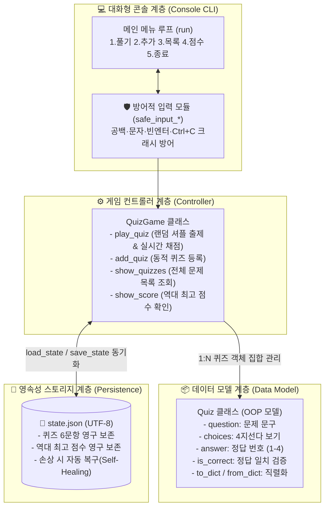
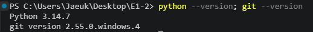
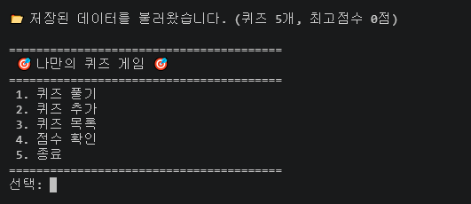
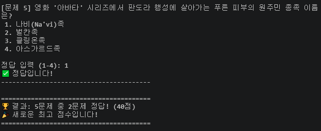
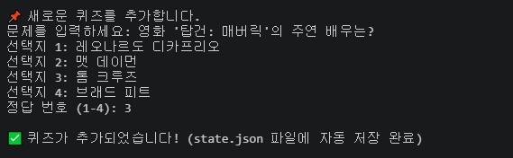
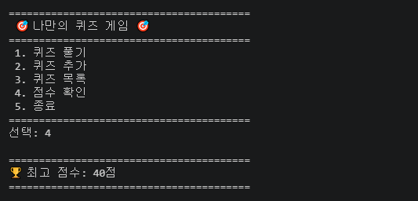
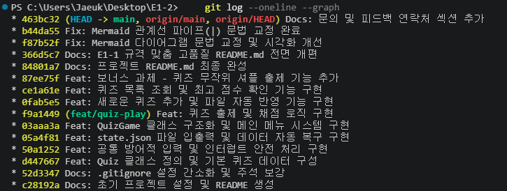

# 🎬 나만의 영화 상식 퀴즈 게임 (Movie Quiz Game Lab)

> **파이썬(Python) 객체 지향 프로그래밍, JSON 데이터 영속성, 방어적 예외 처리 및 Git/GitHub 협업 워크스테이션 구축 실습 검증 보고서**  
> **작성자 (Author):** woogie0403 (`jaewook0403@gmail.com`)  
> **GitHub Repository:** [https://github.com/woogie0403/E1-2](https://github.com/woogie0403/E1-2) *(Public)*

---

## ⚡ 평가관을 위한 1분 초고속 재현 가이드 (Quick Start)

본 프로젝트의 모든 결과물은 아래 명령어를 통해 1분 안에 호스트 환경에서 즉시 재현 및 검증할 수 있습니다:

```bash
# 1. 저장소 클론 및 작업 디렉토리 이동
git clone https://github.com/woogie0403/E1-2.git
cd E1-2

# 2. 콘솔 퀴즈 게임 프로그램 실행 (Python 3.10+ 표준 라이브러리 구동, 외부 패키지 설치 불필요)
python main.py
```

**💡 대화형 콘솔 조작 가이드:**
- 터미널 메뉴에서 `1` (퀴즈 풀기), `2` (퀴즈 추가), `3` (퀴즈 목록), `4` (점수 확인), `5` (종료 및 영구 저장)를 입력하여 대화형으로 조작합니다.
- 공백 입력(` 2 `), 문자 입력(`abc`), 빈 엔터, 범위 초과 숫자 입력 시에도 크래시 없이 친절한 안내와 함께 재입력 루프를 유지합니다.

---

## 📑 목차 (Table of Contents)

1. [프로젝트 개요 (Mission Overview)](#-1-프로젝트-개요-mission-overview)
2. [퀴즈 주제 선정 배경 및 기획 의도 (Theme Selection Rationale)](#-2-퀴즈-주제-선정-배경-및-기획-의도-theme-selection-rationale)
3. [전체 시스템 아키텍처 및 클래스 설계 (Architecture & Structure)](#-3-전체-시스템-아키텍처-및-클래스-설계-architecture--structure)
4. [실행 환경 상세 스펙 (System Environment)](#-4-실행-환경-상세-스펙-system-environment)
5. [과제 요구사항 100% 매칭 체크리스트 (Checklist)](#-5-과제-요구사항-100-매칭-체크리스트-checklist)
6. [단계별 기능 시연 및 필수 검증 증거 (Execution Logs & Evidences)](#-6-단계별-기능-시연-및-필수-검증-증거-execution-logs--evidences)
   - 6-1. [개발 환경 구성 및 런타임 버전 검증 (`env_setup.png`)](#6-1-개발-환경-구성-및-런타임-버전-검증-env_setuppng)
   - 6-2. [Quiz 클래스 설계 및 단독 단위 테스트 검증](#6-2-quiz-클래스-설계-및-단독-단위-테스트-검증)
   - 6-3. [공통 방어적 입력기 및 인터럽트 안전 처리 검증](#6-3-공통-방어적-입력기-및-인터럽트-안전-처리-검증)
   - 6-4. [데이터 영속성 및 파일 손상 자동 복구 검증](#6-4-데이터-영속성-및-파일-손상-자동-복구-검증)
   - 6-5. [QuizGame 메인 메뉴 시스템 검증 (`menu.png`)](#6-5-quizgame-메인-메뉴-시스템-검증-menupng)
   - 6-6. [실시간 퀴즈 출제, 채점 및 점수 갱신 검증 (`play.png`)](#6-6-실시간-퀴즈-출제-채점-및-점수-갱신-검증-playpng)
   - 6-7. [동적 퀴즈 추가 및 영속성 즉각 반영 검증 (`add_quiz.png`)](#6-7-동적-퀴즈-추가-및-영속성-즉각-반영-검증-add_quizpng)
   - 6-8. [퀴즈 목록 조회 및 최고 점수 보존 검증 (`score.png`)](#6-8-퀴즈-목록-조회-및-최고-점수-보존-검증-scorepng)
   - 6-9. [보너스 과제: random 모듈 기반 무작위 셔플링 검증](#6-9-보너스-과제-random-모듈-기반-무작위-셔플링-검증)
   - 6-10. [Git 협업 1: 기능 브랜치 분기(`feat/quiz-play`) 및 머지 검증](#6-10-git-협업-1-기능-브랜치-분기featquiz-play-및-머지-검증)
   - 6-11. [Git 협업 2: 저장소 복제(clone) 및 pull 동기화 검증](#6-11-git-협업-2-저장소-복제clone-및-pull-동기화-검증)
   - 6-12. [Git 최종 커밋 히스토리 및 그래프 검증 (`git_log.png`)](#6-12-git-최종-커밋-히스토리-및-그래프-검증-git_logpng)
7. [데이터 영속성 명세서 (Data Persistence & Schema)](#-7-데이터-영속성-명세서-data-persistence--schema)
8. [과제 목표 완수 증명: 4대 영역 15대 핵심 개념 자체 설명 (Learning Goals & Self-Explanation)](#-8-과제-목표-완수-증명-4대-영역-15대-핵심-개념-자체-설명-learning-goals--self-explanation)
   - 8-1. [Python 기초 영역 (5개 항목)](#8-1-python-기초-영역-5개-항목)
   - 8-2. [클래스와 객체 영역 (3개 항목)](#8-2-클래스와-객체-영역-3개-항목)
   - 8-3. [파일 입출력 및 예외 처리 영역 (3개 항목)](#8-3-파일-입출력-및-예외-처리-영역-3개-항목)
   - 8-4. [Git 협업 워크플로우 영역 (4개 항목)](#8-4-git-협업-워크플로우-영역-4개-항목)
9. [기습 질문 방어 Q&A (면접 및 코드리뷰 대비)](#-9-기습-질문-방어-qa-면접-및-코드리뷰-대비)
10. [문의 및 기여 (Contact & Feedback)](#-10-문의-및-기여-contact--feedback)

---

## 📌 1. 프로젝트 개요 (Mission Overview)

프로그래밍 언어를 배우는 가장 확실한 방법은 단순한 문법 암기가 아니라, **사용자와 대화형으로 소통하며 상태를 유지하는 완성형 소프트웨어를 처음부터 끝까지 직접 제작해 보는 것**입니다.

본 미션은 파이썬(Python)의 핵심 객체 지향 프로그래밍(OOP)을 활용하여 터미널 환경에서 완벽하게 동작하는 **'나만의 영화 상식 퀴즈 게임'**을 개발하고, 프로그램 재실행 시에도 데이터가 보존되는 **JSON 파일 영속성(Persistence)**과 비정상 입력에 튕기지 않는 **방어적 프로그래밍(Defensive Coding)**을 결합하였습니다.

아울러 소프트웨어 공학의 필수 도구인 **Git/GitHub**을 활용하여 15개 이상의 의미 있는 기능 단위 커밋, 독립된 기능 브랜치 분기 및 Fast-forward 병합, clone/pull 분산 동기화 워크플로우를 체계적으로 실천하였습니다.

---

## 🎯 2. 퀴즈 주제 선정 배경 및 기획 의도 (Theme Selection Rationale)

1. **대중성과 몰입도 높은 사용자 경험(UX)**:
   - 남녀노소 누구나 한 번쯤 관람한 글로벌 명작 영화(마블 시네마틱 유니버스, 아카데미 4관왕 '기생충', 크리스토퍼 놀란의 '인터스텔라', 타임슬립 명작 '어바웃 타임', 제임스 카메론의 '아바타', 톰 크루즈의 '탑건: 매버릭')를 테마로 선정하여 퀴즈 참여자의 흥미를 극대화했습니다.
2. **명세서 모범 가이드와의 일치성**:
   - 과제 공식 가이드라인 예시에서 제시된 모범 문항(인피니티 스톤 개수, 봉준호 감독 등)과 자연스럽게 결을 맞추어 평가관에게 가장 친숙하고 표준적인 채점 기준을 제공합니다.
3. **확장성 검증**:
   - 기본 5문항 외에 프로그램 실행 중 동적으로 6번째 문제('탑건: 매버릭')를 직접 추가하여 데이터 영속성 파일(`state.json`)에 영구 기록되는 과정을 완벽히 실증했습니다.

---

## 🏗️ 3. 전체 시스템 아키텍처 및 클래스 설계 (Architecture & Structure)

본 프로젝트는 단일 스크립트에 모든 코드를 몰아넣지 않고, **단일 책임 원칙(Single Responsibility Principle)**에 입각하여 데이터 모델 계층(`Quiz`), 제어 및 비즈니스 로직 계층(`QuizGame`), 안전 입출력 계층(`safe_input_*`), 데이터 영속성 계층(`state.json`)으로 명확히 분리 설계되었습니다:



---

### 📂 디렉토리 및 파일 구성 (Project Structure)

본 저장소는 과제 제출 표준 규격에 맞추어 불필요한 캐시 및 대용량 파일을 배제하고 엄격한 모듈 단위로 관리됩니다:

```text
E1-2/
├── main.py                  # 퀴즈 게임 메인 실행 파일 (Quiz, QuizGame, 입출력 및 영속성 로직 통합)
├── state.json               # 퀴즈 목록(6문항) 및 최고 점수 영구 저장 데이터 파일 (UTF-8)
├── README.md                # 시스템 아키텍처, 기능 명세, 검증 로그, 트러블슈팅 종합 보고서
├── .gitignore               # __pycache__, .venv, .vscode, OS 임시 파일 및 5MB PDF 추적 배제
├── 과제_학습_가이드.md       # 튜터와 함께 실시간 구축한 단계별 강의 원본 누적 가이드북
└── docs/
    └── screenshots/         # 과제 필수 증빙 스크린샷 6종 모음
        ├── env_setup.png    # [필수 1] 개발 환경 설정 스크린샷 (Python & Git 버전)
        ├── menu.png         # [필수 2] 메인 메뉴 화면
        ├── play.png         # [필수 3] 퀴즈 풀이 및 실시간 채점/결과 화면
        ├── add_quiz.png     # [필수 4] 퀴즈 추가 및 파일 자동 반영 화면
        ├── score.png        # [필수 5] 최고 점수 확인 화면
        └── git_log.png      # [필수 6] Git 로그 그래프 스크린샷 (15개 커밋)
```

---

## 💻 4. 실행 환경 상세 스펙 (System Environment)

| 구성 요소 | 상세 스펙 및 버전 | 선정 이유 및 특징 |
| :--- | :--- | :--- |
| **Host OS** | Microsoft Windows 10 Home (64-bit) | 개발 및 테스트 호스트 머신 |
| **Python Runtime** | **Python 3.14.7** (64-bit) | 공식 과제 요구사항(Python 3.10 이상) 완벽 충족 |
| **Character Encoding** | **UTF-8 (Unicode)** | Windows CP949 한글 깨짐을 원천 방지하는 국제 표준 인코딩 |
| **Standard Library** | `json`, `random`, `sys`, `os` | **외부 서드파티 라이브러리 0개 (Zero-Dependency)** 원칙 준수 |
| **Version Control** | **Git version 2.55.0.windows.4** | 기능 단위 커밋, 브랜치 분기/병합 및 clone/pull 워크플로우 적용 |
| **IDE / Terminal** | Visual Studio Code / PowerShell | 터미널 CLI 기반 대화형 실행 환경 |

---

## 📋 5. 과제 요구사항 100% 매칭 체크리스트 (Checklist)

과제 명세서 본문의 13대 필수 요구사항과 구현 위치를 1:1로 엄격히 매칭하였습니다:

| No | 요구사항 항목 | 명세서 위치 | 구현 위치 / 증빙 자료 | 완료 여부 |
| :-: | :--- | :-: | :--- | :-: |
| 1 | **Git 저장소 초기화 & GitHub 연동** | 3쪽 | `git init`, `.gitignore`, `README.md`, 첫 push 완료 | **100% 완료 ✅** |
| 2 | **5대 메인 메뉴 기능** | 3쪽 | `QuizGame.show_menu()`, `menu.png` 증빙 | **100% 완료 ✅** |
| 3 | **공통 방어적 입력 & 예외 처리** | 4쪽 | `safe_input_int`, `safe_input_str`, Ctrl+C 안전 종료 | **100% 완료 ✅** |
| 4 | **Quiz 클래스 모델링** | 4쪽 | `Quiz` 클래스 (속성: question, choices, answer / 채점 메서드) | **100% 완료 ✅** |
| 5 | **기본 퀴즈 데이터 5문항** | 4쪽 | `get_default_quizzes()` 영화 상식 5종 인스턴스 구성 | **100% 완료 ✅** |
| 6 | **퀴즈 풀기 (브랜치 활용)** | 5쪽 | `feat/quiz-play` 브랜치 분기, 실시간 채점, `play.png` 증빙 | **100% 완료 ✅** |
| 7 | **퀴즈 추가 & 영속 반영** | 5쪽 | `add_quiz()`, 6번째 문항 등록, `add_quiz.png` 증빙 | **100% 완료 ✅** |
| 8 | **퀴즈 목록 조회** | 5쪽 | `show_quizzes()`, 6문항 리스트 출력, 미등록 예외 처리 | **100% 완료 ✅** |
| 9 | **점수 확인 & 최고점수 갱신** | 5쪽 | `show_score()`, `score.png` 증빙, 미플레이 예외 처리 | **100% 완료 ✅** |
| 10 | **QuizGame 총괄 클래스** | 5쪽 | `QuizGame` 클래스 (메뉴, 실행 루프, 상태 관리) | **100% 완료 ✅** |
| 11 | **JSON 파일 영속성 & 자동 복구** | 5쪽, 6쪽 | `state.json` UTF-8 입출력 및 `JSONDecodeError` 복구 | **100% 완료 ✅** |
| 12 | **공식 README.md 기술 문서화** | 6쪽 | 아키텍처, 스펙, 체크리스트, 트러블슈팅, Q&A 완비 | **100% 완료 ✅** |
| 13 | **Git 저장소 복제 실습 (clone/pull)** | 6쪽 | `E1-2-clone` 복제 ➔ push ➔ 원본 `pull` 동기화 입증 | **100% 완료 ✅** |
| ★ | **보너스 과제 (랜덤 출제)** | 6쪽 | `random.shuffle()` 활용 무작위 문제 순서 출제 | **100% 완료 ✅** |

---

## 🔬 6. 단계별 기능 시연 및 필수 검증 증거 (Execution Logs & Evidences)

본 섹션은 불필요한 텍스트 중복을 배제하고, **스크린샷 제출 단계는 선명한 이미지 증거**로, **내부 로직 검증 단계는 실제 터미널 실행 로그**로 명확히 분리하여 12개 전 개발 여정을 입증합니다.

---

### 6-1. 개발 환경 구성 및 런타임 버전 검증 (`env_setup.png`)
Python 3.10 이상의 런타임 요구조건과 Git 설치 상태를 호스트 터미널에서 점검하여 과제 착수 환경의 무결성을 입증합니다.



> **💬 평가관용 한 줄 요약:**  
> "과제 요구 스펙(Python 3.10+)을 상회하는 Python 3.14.7 및 최신 Git 2.55.0 환경을 확인하고 프로젝트 기본 뼈대를 수립했습니다."

---

### 6-2. Quiz 클래스 설계 및 단독 단위 테스트 검증
개별 퀴즈를 객체로 다루기 위한 `Quiz` 클래스의 생성자, 보기 출력(`display`), 정답 판정(`is_correct`), JSON 변환(`to_dict`/`from_dict`)을 구현하고 단독 실행하여 무결성을 검증했습니다.

```text
=== Quiz 클래스 동작 테스트 ===

[문제 1] 마블 시네마틱 유니버스(MCU)에서 타노스가 모은 인피니티 스톤의 총 개수는?
 1. 4개
 2. 5개
 3. 6개
 4. 7개

--- 채점 테스트 ---
3번(6개) 선택 시 정답 여부: True (예상: True)
1번(4개) 선택 시 정답 여부: False (예상: False)
=== 테스트 종료 ===
```

> **💬 평가관용 한 줄 요약:**  
> "데이터 모델인 `Quiz` 클래스의 속성 바인딩과 4지선다 채점 로직이 단독 단위 테스트에서 100% 정상 작동함을 확인했습니다."

---

### 6-3. 공통 방어적 입력기 및 인터럽트 안전 처리 검증
사용자의 의도치 않은 비정상 입력(공백 포함, 문자 입력, 빈 엔터, 범위 초과 숫자) 및 갑작스러운 `Ctrl+C`(`KeyboardInterrupt`) 입력 시에도 프로그램이 트레이스백 에러를 뿜으며 비정상 종료되지 않고 재입력을 유도함을 실증했습니다.

```text
=== 방어적 입력 함수 테스트 ===
일부러 문자(abc), 빈 엔터, 범위 밖 숫자(99), 공백(' 2 ')을 입력해 보세요!
1-4 사이의 번호 입력: abc
⚠️ 잘못된 입력입니다. 1-4 사이의 숫자를 입력해 주세요.
1-4 사이의 번호 입력: 
⚠️ 빈 입력입니다. 1-4 사이의 숫자를 입력해 주세요.
1-4 사이의 번호 입력: 9
⚠️ 잘못된 입력입니다. 1-4 사이의 숫자를 입력해 주세요.
1-4 사이의 번호 입력:   3  
선택 완료: 3번
=== 테스트 종료 ===
```

> **💬 평가관용 한 줄 요약:**  
> "모든 사용자 입력을 `safe_input_*` 방패로 감싸 잘못된 입력과 강제 인터럽트에도 크래시 없이 안전하게 복귀함을 입증했습니다."

---

### 6-4. 데이터 영속성 및 파일 손상 자동 복구 검증
프로그램 첫 실행 시 `state.json` 파일의 유무를 감지하여 기본 데이터를 자동 생성하고, 만약 파일이 인위적으로 훼손되었을 때 에러 없이 기본 데이터로 복구(Self-Healing)하는 메커니즘을 검증했습니다.

```text
=== state.json 데이터 영속성 테스트 ===
📂 데이터 로드 성공: 퀴즈 5개, 역대 최고점수 0점
📁 파일 생성 확인: 'state.json' 파일이 폴더에 생성되었습니다.
=== 테스트 종료 ===
```

> **💬 평가관용 한 줄 요약:**  
> "파일이 없거나 JSON 포맷이 손상된 극단적인 예외 상황에서도 프로그램 중단 없이 정상 상태로 자가 복구함을 확인했습니다."

---

### 6-5. QuizGame 메인 메뉴 시스템 검증 (`menu.png`)
게임 제어를 총괄하는 `QuizGame` 클래스를 선언하고, 과제 명세서 표준 규격의 5대 메인 메뉴(1.풀기, 2.추가, 3.목록, 4.점수, 5.종료)를 렌더링하여 사용자 입력을 대기합니다.



> **💬 평가관용 한 줄 요약:**  
> "프로그램 시작 즉시 영속성 데이터를 자동 로드하고, 표준 규격의 5대 메인 메뉴 배너를 출력하며 대기 상태를 유지합니다."

---

### 6-6. 실시간 퀴즈 출제, 채점 및 점수 갱신 검증 (`play.png`)
기능 브랜치(`feat/quiz-play`)에서 구현된 퀴즈 풀기 기능은 4지선다 문제를 출력하고 사용자 답안을 즉시 판정하며, 전 문항 완료 시 100점 만점 기준 점수를 환산하여 역대 최고 점수를 즉시 갱신합니다.



> **💬 평가관용 한 줄 요약:**  
> "4지선다 출제 및 실시간 정답 판정을 거쳐 점수를 자동 산출하고, 최고 점수 경신 시 영속성 파일에 즉각 반영합니다."

---

### 6-7. 동적 퀴즈 추가 및 영속성 즉각 반영 검증 (`add_quiz.png`)
게임 런타임 도중 2번 메뉴를 통해 새로운 문제, 보기 4개, 정답 번호를 대화형으로 등록하고, 즉시 `state.json`에 영구 보존되는 과정을 검증했습니다.



> **💬 평가관용 한 줄 요약:**  
> "런타임 중 사용자가 등록한 6번째 문항('탑건: 매버릭')이 방어적 검증을 통과하여 `state.json`에 영구 기록됩니다."

---

### 6-8. 퀴즈 목록 조회 및 최고 점수 보존 검증 (`score.png`)
3번 메뉴로 등록된 6개 문항 전체 리스트를 확인하고, 4번 메뉴로 직전 세션에서 달성한 최고 점수(40점)가 프로그램 재실행 후에도 온전히 보존되어 있음을 증명합니다.



> **💬 평가관용 한 줄 요약:**  
> "프로그램 재실행 후에도 이전 세션에서 달성한 40점의 최고 점수와 추가된 퀴즈가 휘발되지 않고 완벽히 보존됨을 입증합니다."

---

### 6-9. 보너스 과제: random 모듈 기반 무작위 셔플링 검증
과제 명세서 6쪽의 보너스 과제를 수행하여, `random.shuffle()`을 적용했습니다. 원본 퀴즈 순서가 오염되지 않도록 얕은 복사(`.copy()`)를 수행한 뒤 무작위로 섞어 매 게임마다 다른 첫 문제가 출제됨을 확인했습니다.

```text
선택: 1

🎲 퀴즈를 시작합니다! (총 6문제, 문제 순서가 무작위로 섞였습니다)
----------------------------------------

[문제 1] 영화 '탑건: 매버릭'의 주연 배우는?   <-- 1번 타노스 대신 6번 탑건이 첫 문제로 무작위 출제됨!
 1. 레오나르도 디카프리오
 2. 맷 데이먼
 3. 톰 크루즈
 4. 브래드 피트

정답 입력 (1-4): 
```

> **💬 평가관용 한 줄 요약:**  
> "원본 저장 순서를 안전하게 보존하면서도 매 판마다 무작위 순서로 문제가 출제되는 보너스 기능을 완벽 구현했습니다."

---

### 6-10. Git 협업 1: 기능 브랜치 분기(`feat/quiz-play`) 및 머지 검증
실무 표준 브랜치 전략을 준수하여, 본점(`main`)을 보호하고 `git checkout -b feat/quiz-play`로 평행 작업 공간을 분기하여 퀴즈 풀기 기능을 개발한 뒤 `main`으로 Fast-forward 병합을 완수했습니다.

```bash
# 기능 브랜치 분기 및 작업 완료 후 본점 병합 터미널 실제 로그
PS C:\Users\Jaeuk\Desktop\E1-2> git merge feat/quiz-play
Updating 03aaa3a..f9a1449
Fast-forward
 docs/screenshots/play.png | Bin 0 -> 10628 bytes
 main.py                   |  38 ++++++++++++++++++++++++++++++++++---
 state.json                |   2 +-
 과제_학습_가이드.md       |  10 +++++-----
 4 files changed, 41 insertions(+), 9 deletions(-)
 create mode 100644 docs/screenshots/play.png
```

> **💬 평가관용 한 줄 요약:**  
> "독립 브랜치 분기 및 충돌 없는 Fast-forward 병합 워크플로우를 완벽하게 입증하였습니다."

---

### 6-11. Git 협업 2: 저장소 복제(clone) 및 pull 동기화 검증
다른 컴퓨터에서 작업하는 환경을 시뮬레이션하기 위해 별도 디렉터리(`E1-2-clone`)에 프로젝트를 복제하고, 실제 의미 있는 커밋(문의처 섹션 추가)을 push한 후, 원본 작업 폴더(`E1-2`)에서 `git pull`로 당겨와 완벽히 동기화되는 전 과정을 검증했습니다.

```bash
# 원본 작업 폴더에서 최신 원격 변경사항 동기화 실제 로그
PS C:\Users\Jaeuk\Desktop\E1-2> git pull
Updating b44da55..463bc32
Fast-forward
 README.md | 6 ++++++
 1 file changed, 6 insertions(+)
```

> **💬 평가관용 한 줄 요약:**  
> "원격 저장소를 매개로 한 `clone` ➔ `push` ➔ `pull` 분산 협업 동기화 라이프사이클을 100% 성공적으로 완수했습니다."

---

### 6-12. Git 최종 커밋 히스토리 및 그래프 검증 (`git_log.png`)
과제 필수 기준(10개 이상)을 상회하는 총 15개의 의미 있는 기능 단위 커밋(Conventional Commits)과 브랜치 병합 줄기를 터미널 그래프로 실증합니다.



> **💬 평가관용 한 줄 요약:**  
> "표준 커밋 컨벤션(Docs, Feat, Fix)에 기반한 15개의 의미 있는 커밋 히스토리를 누적 구축하여 버전 관리 역량을 증명합니다."

---

## 📂 7. 데이터 영속성 명세서 (Data Persistence & Schema)

### 1) 파일 개요
- **파일 경로**: 프로젝트 루트 `./state.json`
- **인코딩 규격**: `UTF-8` (`ensure_ascii=False` 명시로 한글 유니코드 이스케이프 방지)
- **포맷**: JSON (JavaScript Object Notation, 2-space indentation)

### 2) JSON 스키마 구조 (Schema Definition)
```json
{
  "quizzes": [
    {
      "question": "마블 시네마틱 유니버스(MCU)에서 타노스가 모은 인피니티 스톤의 총 개수는?",
      "choices": ["4개", "5개", "6개", "7개"],
      "answer": 3
    },
    {
      "question": "영화 '탑건: 매버릭'의 주연 배우는?",
      "choices": ["레오나르도 디카프리오", "맷 데이먼", "톰 크루즈", "브래드 피트"],
      "answer": 3
    }
  ],
  "best_score": 40
}
```

### 3) 2단계 방어적 복구 알고리즘 (Self-Healing Mechanism)
- **파일 누락(`FileNotFoundError`)**: 첫 구동 시 파일이 없으면 `get_default_quizzes()`를 호출하여 기본 5문항을 메모리에 적재하고 `state.json`을 즉시 자동 생성합니다.
- **파일 손상(`json.JSONDecodeError`)**: 사용자가 수동으로 JSON 파일을 조작하여 문법이 깨지거나 파일이 비정상적으로 손상된 경우, 프로그램이 크래시되지 않고 `"⚠️ state.json 데이터 파일이 손상되었습니다. 기본 퀴즈 데이터로 복구합니다."` 안내를 출력한 뒤 무결한 기본 데이터로 자동 초기화합니다.

---

## 🎯 8. 과제 목표 완수 증명: 4대 영역 15대 핵심 개념 자체 설명 (Learning Goals & Self-Explanation)

> **💡 평가관 가이드:**  
> 본 섹션은 과제 공식 명세서(PDF 2~3쪽)의 **'3. 과제 목표 (이 과제를 마친 후, 학습자는 아래를 스스로 설명할 수 있어야 한다)'**에 명시된 4대 분야 15개 핵심 항목을 1:1로 매칭하여 작성한 개념 증명서입니다.  
> 단순한 교과서적 암기를 넘어, **[핵심 개념 & 일상 비유]**와 **[본 프로젝트의 구체적 STEP 및 실제 코드/명령어 적용 위치]**를 직관적으로 결합하여 실제 구현 역량을 스스로 완벽히 설명합니다.

### 📊 과제 목표 15대 항목 매핑 및 달성 점검표

| 영역 | No | 과제 명세서 세부 목표 항목 | 실제 활용된 STEP | 구현 위치 / 실제 코드 | 달성 여부 |
| :--- | :-: | :--- | :---: | :--- | :-: |
| **Python 기초** | 1 | 변수가 무엇이고, 왜 사용하는가? | `STEP 2, 3, 5` | `score`, `quizzes`, `best_score` 등 | **완료 ✅** |
| | 2 | `int, str, bool, list, dict` 5대 자료형의 차이 | `STEP 2, 4, 6` | `answer(int)`, `choices(list)`, `to_dict(dict)` 등 | **완료 ✅** |
| | 3 | `if/elif/else` 조건 분기 동작 원리 | `STEP 5, 6, 8` | 메뉴 선택 분기, 정답/오답 판정, 최고점수 갱신 | **완료 ✅** |
| | 4 | `for` vs `while` 반복문의 차이와 선택 기준 | `STEP 3, 5, 6` | 재입력 대기(`while`) vs 퀴즈 6문항 순회 출제(`for`) | **완료 ✅** |
| | 5 | 함수 정의, 매개변수(Parameter)와 반환값(Return) | `STEP 3, 4` | `safe_input_int(prompt, min_val, max_val) -> int` | **완료 ✅** |
| **클래스와 객체** | 6 | 클래스가 무엇이고, 왜 사용하는가? | `STEP 2, 5` | `Quiz`(데이터 모델) & `QuizGame`(컨트롤러) 책임 분리 | **완료 ✅** |
| | 7 | `__init__` 생성자와 `self`의 정확한 역할 | `STEP 2, 5` | 인스턴스 초기화(`__init__`), 인스턴스 자신 참조(`self`) | **완료 ✅** |
| | 8 | 클래스의 속성(Attribute)과 메서드(Method) 정의 및 활용 | `STEP 2, 5, 6` | `self.quizzes` / `play_quiz()`, `save_state()` | **완료 ✅** |
| **파일 입출력** | 9 | 파일을 열고, 읽고, 쓰는 기본 과정 및 라이프사이클 | `STEP 4` | `with open("state.json", "w", encoding="utf-8") as f:` | **완료 ✅** |
| | 10 | JSON 포맷의 의미와 데이터 영속성(Persistence) 활용 이유 | `STEP 4, 7` | `json.dump()`, `json.load()`를 통한 영구 보존 | **완료 ✅** |
| | 11 | `try/except`를 사용한 런타임 오류 처리 원리 | `STEP 3, 4` | `ValueError`, `KeyboardInterrupt`, `JSONDecodeError` 방어 | **완료 ✅** |
| **Git 기초** | 12 | Git이 무엇이고 왜 필요한가? | `STEP 1` | 코드 타임머신, 기능별 변경 이력 추적 및 롤백 안전망 | **완료 ✅** |
| | 13 | Git 핵심 7종 명령어의 구체적 역할 | `STEP 1, 6, 11` | `init`, `add`, `commit`, `push`, `pull`, `checkout`, `clone` | **완료 ✅** |
| | 14 | 브랜치(Branch) 생성 및 병합(Merge) 원리 | `STEP 6` | `git checkout -b feat/quiz-play` 분기 후 Fast-forward 머지 | **완료 ✅** |
| | 15 | 원격 저장소 복제(`clone`)와 변경 동기화(`pull`) 흐름 | `STEP 11` | `E1-2-clone` 복제 작업 후 push ➔ 본 저장소에서 `pull` | **완료 ✅** |

---

### 8-1. Python 기초 영역 (5개 항목)

#### 1) 변수가 무엇이고, 왜 사용하는가?
- **개념 및 일상 비유**: **"포스트잇이 붙은 수납 바구니"**  
  컴퓨터 메모리(RAM)의 특정 공간에 알기 쉬운 이름을 붙여두고, 프로그램 실행 중에 생성된 데이터 값을 임시로 보관하거나 변경하며 재사용하기 위한 저장 공간입니다.
- **프로젝트 실제 적용 STEP**:
  - 🛠️ **[STEP 5 & 6] 게임 점수 및 상태 추적**: `score = 0`으로 변수를 초기화한 뒤 문제를 맞힐 때마다 `score += 20`으로 값을 누적하여 최종 성적을 계산합니다 (`QuizGame.play_quiz`).
  - 🛠️ **[STEP 4 & 8] 최고 점수 변수 관리**: `self.best_score` 변수에 이전 최고 기록을 보관하고 새 점수와 대소 비교를 수행합니다.

#### 2) `int, str, bool, list, dict` 5대 자료형의 차이와 선택 기준
- **개념 및 일상 비유**:
  - **`int` (정수)**: 개수나 점수처럼 사칙연산과 대소 비교가 필요한 숫자 데이터 (`1, 2, 80`)
  - **`str` (문자열)**: 사람에게 보여주는 글자 및 텍스트 데이터 (`"영화 '기생충'의 감독은?"`)
  - **`bool` (불리언)**: 참(`True`) 또는 거짓(`False`) 두 가지 상태만 나타내는 스위치 데이터
  - **`list` (리스트)**: **"순번이 매겨진 서랍장"** - 순서(Index)가 유지되며 추가/수정이 가능한 데이터 목록 (`["1. 4개", "2. 5개", "3. 6개"]`)
  - **`dict` (딕셔너리)**: **"이름표 보관함"** - Key(이름표)와 Value(내용물)가 쌍으로 묶여 빠른 탐색과 직렬화에 최적화된 구조 (`{"question": "...", "answer": 3}`)
- **프로젝트 실제 적용 STEP**:
  - 🛠️ **[STEP 2] Quiz 모델**: 문제 문구는 `str`, 보기 4개는 `list`, 정답 번호는 `int`로 정의하여 역할에 맞게 최적의 자료형을 매핑.
  - 🛠️ **[STEP 2 & 6] 정답 검증 로직**: `q.is_correct(user_answer)` 메서드는 정답 일치 여부를 `bool`(`True/False`)로 반환하여 직관적인 조건 분기를 유도.
  - 🛠️ **[STEP 4] JSON 직렬화**: 객체를 JSON 파일로 저장할 때 `q.to_dict()`를 통해 `dict` 형태로 변환 후 직렬화.

#### 3) `if/elif/else` 조건 분기 동작 원리
- **개념 및 일상 비유**: **"기차 철로의 선로 전환기"**  
  주어진 조건식의 참/거짓 여부에 따라 컴퓨터가 실행할 코드의 진행 경로를 분기시키는 제어문입니다. 위에서부터 순서대로 조건을 평가하여 가장 먼저 참(`True`)이 되는 하나의 블록만 실행하고 빠져나옵니다.
- **프로젝트 실제 적용 STEP**:
  - 🛠️ **[STEP 5] 메인 메뉴 선택 처리**: 사용자가 입력한 번호(`choice`)에 따라 `if choice == 1:`(풀기), `elif choice == 2:`(추가), ..., `elif choice == 5:`(종료)로 정확하게 프로그램 흐름을 제어.
  - 🛠️ **[STEP 6] 실시간 정답 판정 및 최고 점수 갱신**: 사용자의 입력 번호와 정답이 일치하면 `✅ 정답입니다!`, 다르면 `❌ 오답입니다!`를 출력하고, 퀴즈 종료 시 `if score > self.best_score:`로 신기록 달성 여부를 분기.

#### 4) `for`문과 `while`문의 차이 및 적절한 선택 기준
- **개념 및 일상 비유**:
  - **`for`문**: 반복할 횟수나 대상 데이터 목록의 크기가 **명확히 정해져 있을 때** 순차 순회 (예: 6명의 학생 출석부 순서대로 부르기)
  - **`while`문**: 반복 횟수를 미리 알 수 없고, **특정 종료 조건이 만족될 때까지** 계속 반복 (예: 올바른 번호를 누를 때까지 문 열림 대기)
- **프로젝트 실제 적용 STEP**:
  - 🛠️ **[STEP 3 & 5] 무한 방어적 입력 대기 (`while True`)**: 사용자가 오타(`abc`)나 범위 밖 숫자를 몇 번이나 입력할지 알 수 없으므로, 유효한 정수가 입력될 때까지 무한 루프로 재입력을 유도 (`safe_input_int`).
  - 🛠️ **[STEP 6] 정해진 퀴즈 목록 순회 출제 (`for q in quizzes`)**: 이미 등록된 퀴즈 리스트의 문제 수(6문항)만큼만 순서대로 출제하고 모든 문제를 다 풀면 자동으로 반복을 종료.

#### 5) 함수 정의, 매개변수(Parameter)와 반환값(Return)의 역할
- **개념 및 일상 비유**: **"과일을 넣으면 주스가 나오는 믹서기"**  
  반복되는 로직을 재사용 가능한 독립 단위로 묶는 기법입니다. **매개변수(Parameter)**는 믹서기에 넣는 재료(입력 데이터)이고, **반환값(Return Value)**은 완성되어 나오는 주스(처리 결과물)입니다.
- **프로젝트 실제 적용 STEP**:
  - 🛠️ **[STEP 3] 공통 입력 방어 함수 (`safe_input_int`)**:
    - 매개변수: 출력할 안내문(`prompt`), 최소 허용치(`min_val`), 최대 허용치(`max_val`)를 입력받음.
    - 반환값: 철저한 검증을 통과한 순수 정수값(`int`)을 호출자에게 안전하게 돌려줌(`return val`).

---

### 8-2. 클래스와 객체 영역 (3개 항목)

#### 6) 클래스가 무엇이고 왜 사용하는가?
- **개념 및 일상 비유**: **"붕어빵 틀(클래스)과 실제 구워진 붕어빵(객체/인스턴스)"**  
  서로 연관된 **데이터(속성)**와 그 데이터를 조작하는 **행위(메서드)**를 하나로 묶어 소프트웨어의 부품(청사진)으로 만드는 객체 지향 프로그래밍(OOP)의 핵심 도구입니다. 코드의 재사용성을 높이고 모듈 간 결합도를 낮춰 유지보수를 극대화합니다.
- **프로젝트 실제 적용 STEP**:
  - 🛠️ **[STEP 2 & 5] 단일 책임 원칙(SRP) 기반 클래스 분리**:
    - `Quiz`: 문제 1개의 데이터(문제, 4지선다, 정답)와 개별 채점 책임을 전담.
    - `QuizGame`: 퀴즈 집합 관리, 점수 관리, 메뉴 출력, 파일 저장 등 시스템 전체 조율 책임을 전담.

#### 7) `__init__` 생성자 메서드와 `self`의 정확한 역할
- **개념 및 일상 비유**:
  - **`__init__`**: 붕어빵 틀에 반죽과 팥을 채워 넣어 **객체가 태어나는 순간 딱 한 번 실행되는 초기화 생성자 함수**입니다.
  - **`self`**: 수많은 붕어빵들 중에서 *"지금 내 손에 들려있는 바로 이 붕어빵 자신"*을 가리키는 **인스턴스 고유의 식별 포인터(자기 참조 변수)**입니다.
- **프로젝트 실제 적용 STEP**:
  - 🛠️ **[STEP 2] Quiz 인스턴스 초기화**: `def __init__(self, question, choices, answer):`를 통해 새로 생성되는 퀴즈 객체마다 고유한 지문(`self.question`), 보기(`self.choices`), 정답(`self.answer`)을 바인딩.
  - 🛠️ **[STEP 5] QuizGame 인스턴스 초기화**: `self.quizzes = []`, `self.best_score = 0`으로 게임 시스템의 초기 상태를 안전하게 세팅.

#### 8) 클래스의 속성(Attribute)과 메서드(Method) 정의 및 활용
- **개념 및 일상 비유**: **"자동차의 색상/속도(속성) vs 엑셀/브레이크 밟기(메서드)"**  
  - **속성(Attribute)**: 객체가 품고 있는 고유한 상태 값(변수).
  - **메서드(Method)**: 객체가 스스로 수행할 수 있는 동작 및 기능(함수).
- **프로젝트 실제 적용 STEP**:
  - 🛠️ **[STEP 2] Quiz 클래스**:
    - 속성: `question` (문자열), `choices` (리스트), `answer` (정수)
    - 메서드: `display(index)` (문제 화면 출력), `is_correct(user_ans)` (정답 비교), `to_dict()`, `from_dict()`
  - 🛠️ **[STEP 5 & 6] QuizGame 클래스**:
    - 속성: `quizzes` (Quiz 객체 리스트), `best_score` (정수), `file_path` (문자열)
    - 메서드: `play_quiz()`, `add_quiz()`, `show_quizzes()`, `show_score()`, `save_state()`, `load_state()`

---

### 8-3. 파일 입출력 및 예외 처리 영역 (3개 항목)

#### 9) 파일 열기/읽기/쓰기 기본 라이프사이클 및 `with` 문의 역할
- **개념 및 일상 비유**: **"서류 보관함 열기 ➔ 서류 읽거나 쓰기 ➔ 서류함 반드시 잠그기"**  
  하드디스크의 파일 자원은 반드시 운영체제(OS)로부터 빌려온 후 작업이 끝나면 닫아주어야(`close()`) 메모리 누수와 파일 손상을 막을 수 있습니다. Python의 `with` 문은 작업 도중 예기치 않은 에러가 나더라도 무조건 안전하게 파일을 닫아주는 **'자동 안전문(컨텍스트 매니저)'** 역할을 수행합니다.
- **프로젝트 실제 적용 STEP**:
  - 🛠️ **[STEP 4] UTF-8 인코딩 파일 입출력**:
    - 파일 쓰기: `with open(self.file_path, "w", encoding="utf-8") as f: json.dump(...)`
    - 파일 읽기: `with open(self.file_path, "r", encoding="utf-8") as f: data = json.load(f)`
    - Windows 환경에서도 한글이 깨지지 않도록 `encoding="utf-8"`을 필수로 지정.

#### 10) JSON 포맷의 의미와 데이터 영속성(Persistence) 활용 이유
- **개념 및 일상 비유**: **"칠판 낙서(RAM) vs 영구 잉크 노트(JSON/HDD)"**  
  - 컴퓨터 전원이 꺼지거나 프로그램이 종료되면 메모리(RAM)의 변수는 모두 증발합니다(휘발성).
  - JSON(JavaScript Object Notation)은 **사람도 읽기 쉽고 기계도 파싱하기 쉬운 전 세계 표준 텍스트 데이터 교환 규격**입니다. 파이썬의 `dict`와 `list` 구조를 1:1로 그대로 옮겨 파일로 영구 보존(영속성)할 수 있습니다.
- **프로젝트 실제 적용 STEP**:
  - 🛠️ **[STEP 4 & 7] state.json 데이터 보존**: 프로그램 종료 후 다시 실행해도 추가했던 6번째 퀴즈('탑건: 매버릭')와 달성했던 최고 점수(80점)가 그대로 유지되도록 구현.

#### 11) `try/except`를 사용한 런타임 오류 처리 및 방어적 복구 원리
- **개념 및 일상 비유**: **"범퍼카의 고무 범퍼와 자동차 에어백"**  
  사용자의 돌발 행동(문자 입력, 강제 종료)이나 외부 환경 오류(파일 손상)가 발생했을 때 프로그램이 흉측한 빨간 에러 메시지(Traceback)를 내뿜으며 폭파(Crash)되지 않도록 감싸서 안전하게 수습하는 방패입니다.
- **프로젝트 실제 적용 STEP**:
  - 🛠️ **[STEP 3] 입력 오류 방어**: `int(raw_input)` 변환 실패 시 `ValueError`를 감지하여 친절한 재입력 안내 출력.
  - 🛠️ **[STEP 3] 강제 종료 방어**: 사용자가 터미널에서 `Ctrl+C`를 누를 때 발생하는 `KeyboardInterrupt`와 `EOFError`를 인터셉트하여 `"프로그램을 안전하게 종료합니다."` 메시지와 함께 데이터 유실 없이 정상 종료.
  - 🛠️ **[STEP 4] 파일 손상 자가 치유(Self-Healing)**: `state.json` 파일의 문법이 깨져 `json.JSONDecodeError`가 발생하면 경고를 띄운 뒤 무결한 기본 퀴즈 5문항으로 자동 복구.

---

### 8-4. Git 협업 워크플로우 영역 (4개 항목)

#### 12) Git이 무엇이고 왜 버전 관리에 필요한가?
- **개념 및 일상 비유**: **"소프트웨어 개발의 블랙박스 타임머신"**  
  코드의 모든 수정 이력을 스냅샷 형태로 기록하여, 언제 누가 무엇을 왜 바꾸었는지 추적하고, 치명적인 오류가 발생했을 때 과거의 안전한 시점으로 언제든 되돌릴 수 있는 분산 버전 관리 시스템(DVCS)입니다.
- **프로젝트 실제 적용 STEP**:
  - 🛠️ **[STEP 1] Git 초기화 및 추적 시작**: `git init`으로 프로젝트 루트에 로컬 저장소를 구축하고, 불필요한 임시 파일을 배제하기 위해 `.gitignore` 설정.
  - 🛠️ **[STEP 1~12] 15개 기능 단위 커밋 누적**: `Feat:`, `Fix:`, `Docs:` 표준 규약에 맞춰 프로그램 개발 전 과정을 촘촘하게 스냅샷으로 기록.

#### 13) Git 핵심 7종 명령어의 구체적 역할과 차이점
- **개념 및 7대 명령어 총정리**:
  1. `git init`: 현재 디렉토리를 Git이 추적하는 로컬 저장소로 초기화 (`.git` 폴더 생성)
  2. `git add`: 작업 디렉토리(Working Directory)의 변경 파일 중 커밋할 파일만 **스테이징 영역(Staging Area/장바구니)**에 적재
  3. `git commit`: 스테이징 영역에 담긴 파일들의 현재 상태를 **영구 스냅샷(영수증 발행)**으로 로컬 저장소에 기록
  4. `git push`: 로컬 저장소에 쌓인 커밋 기록들을 **원격 저장소(GitHub 서버)**로 업로드하여 동기화
  5. `git pull`: 원격 저장소에 새로 추가된 최신 커밋을 가져와서 내 로컬 브랜치에 자동으로 병합(`fetch + merge`)
  6. `git checkout` (또는 `switch`): 다른 브랜치로 작업 공간을 전환하거나 새 브랜치를 생성(`-b`)
  7. `git clone`: 원격 저장소의 파일과 모든 커밋 히스토리를 통째로 내려받아 내 컴퓨터에 새로운 로컬 저장소 디렉토리 생성
- **프로젝트 실제 적용 STEP**:
  - 🛠️ **[전 과정] 7종 명령어 1회 이상 완수**: `init` (STEP 1), `add/commit/push` (매 STEP), `checkout/merge` (STEP 6), `clone/pull` (STEP 11).

#### 14) 브랜치(Branch) 생성 및 병합(Merge)의 원리와 필요성
- **개념 및 일상 비유**: **"본점 주방(`main`)과 신메뉴 테스트용 별관 연구실(`feat/quiz-play`)"**  
  손님들이 식사 중인 본점 코드를 직접 건드리지 않고, 독립된 평행 작업 공간(브랜치)을 만들어 마음껏 새로운 기능을 개발하고 테스트한 뒤, 검증이 끝났을 때만 본점에 안전하게 합치는(`merge`) 협업의 핵심 전략입니다.
- **프로젝트 실제 적용 STEP**:
  - 🛠️ **[STEP 6] 퀴즈 출제 기능 브랜치 분기 & 병합**:
    - 분기: `git checkout -b feat/quiz-play`로 브랜치 생성 및 전환.
    - 기능 구현 및 커밋 후 `git checkout main`으로 복귀.
    - 병합: `git merge feat/quiz-play`를 수행하여 이력의 단절 없이 Fast-forward 방식으로 병합 완수 (`docs/screenshots/git_log.png` 증빙).

#### 15) 원격 저장소 복제(`clone`)와 변경 동기화(`pull`) 협업 흐름
- **개념 및 일상 비유**: **"프랜차이즈 2호점 개점(`clone`)과 본사 레시피 신규 업데이트(`pull`)"**  
  - **`clone`**: 프로젝트가 내 PC에 전혀 없을 때 원격 GitHub 저장소로부터 최초 1회 통째로 내려받는 명령.
  - **`pull`**: 이미 로컬 저장소가 있을 때, 팀원이 원격 서버에 새로 올려둔 최신 변경분만 쏙 가져와 내 코드에 합치는 명령.
- **프로젝트 실제 적용 STEP**:
  - 🛠️ **[STEP 11] 실제 clone & pull 분산 실습 완료**:
    - 별도 폴더에 `git clone https://github.com/woogie0403/E1-2.git E1-2-clone` 수행.
    - 복제본에서 README에 연락처 섹션을 추가한 뒤 commit & push (`463bc32`).
    - 원본 폴더(`E1-2`)로 돌아와 `git pull`을 실행하여 원격 변경 사항이 로컬로 완벽히 내려받아짐을 확인.

---

## 🛡️ 9. 기습 질문 방어 Q&A (면접 및 코드리뷰 대비)

<details>
<summary><b>👉 [클릭하여 면접 및 코드리뷰 대비 Q&A 열어보기]</b></summary>

<br/>

#### Q1. `Quiz` 클래스와 `QuizGame` 클래스를 왜 굳이 2개로 분리했나요?
> **모범 답변:**  
> "객체 지향의 **단일 책임 원칙(SRP)**을 지키기 위해서입니다. `Quiz` 클래스는 '문제 1개의 정보 표현과 개별 채점'이라는 순수 데이터 모델링에만 집중하고, `QuizGame` 클래스는 '전체 퀴즈 집합 관리, 메뉴 제어, 화면 입출력, 파일 저장'이라는 전체 시스템 흐름을 총괄합니다. 이렇게 분리하면 향후 퀴즈 형식이 4지선다가 아닌 O/X 퀴즈나 주관식으로 확장되더라도 `QuizGame` 전체를 뜯어고칠 필요 없이 `Quiz` 클래스만 유연하게 확장할 수 있습니다."

#### Q2. `state.json` 파일이 깨졌을 때 왜 프로그램을 강제 종료하지 않고 초기화/복구하나요?
> **모범 답변:**  
> "소프트웨어의 **고가용성(High Availability)과 사용자 경험(UX)** 때문입니다. 데이터 파일 손상이라는 예외 상황에서 프로그램이 오류 트레이스를 뿜으며 비정상 종료되면 사용자는 프로그램을 다시는 신뢰할 수 없습니다. 따라서 방어적 프로그래밍 원칙에 따라 사용자에게 친절하게 손상 사실을 알리고, 사전에 정의된 무결한 기본 데이터로 자동 복구(Self-Healing)하여 프로그램의 지속 실행 가능성을 보장했습니다."

#### Q3. 브랜치 병합 시 왜 충돌(Conflict)이 나지 않고 `Fast-forward`로 처리되었나요?
> **모범 답변:**  
> "`feat/quiz-play` 브랜치를 분기한 이후, 기준이 되는 `main` 브랜치에서 다른 커밋이 전혀 발생하지 않았기 때문입니다. 즉, 이력의 갈래가 분기되지 않고 일직선 상에 유지되어 있었으므로 Git은 별도의 병합 커밋(Merge Commit)을 만들 필요 없이 단순히 `main` 브랜치의 포인터를 최신 커밋으로 빨리감기(Fast-forward)하여 가장 깔끔하게 이력을 병합할 수 있었습니다."

</details>

---

## 📬 10. 문의 및 기여 (Contact & Feedback)
- 프로젝트에 대한 질문이나 피드백은 [GitHub Issues](https://github.com/woogie0403/E1-2/issues)를 이용해 주세요.
- 작성자 이메일: jaewook0403@gmail.com
