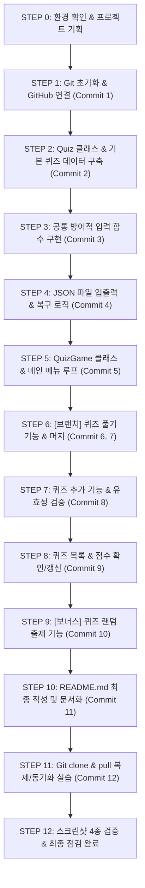

# 📘 [나만의 퀴즈 게임 & Git 협업 마스터] 과제 학습 가이드

---

## 0. [과제 사전 분석 리포트 & 전체 로드맵]

### 1. 과제 한 줄 요약
Python의 기초 문법, 클래스(객체지향), JSON 파일 영속성, 방어적 예외 처리를 활용하여 터미널 기반 '나만의 퀴즈 게임'을 구현하고, Git 핵심 7종 명령어(10개 이상의 의미 있는 커밋, 브랜치 분기·병합, clone/pull)로 버전 관리 전 과정을 완주하는 실전 개발 입문 미션.

---

### 2. 과제의 목적
- **동작하는 소프트웨어의 완주 경험**: 파편화된 문법 암기를 넘어, 실제 입출력과 상태가 유지되는 완전한 프로그램을 처음부터 끝까지 직접 제작.
- **객체지향 프로그래밍(OOP) 구조화**: 단일 스크립트 방식에서 벗어나 `Quiz`(데이터 모델)와 `QuizGame`(게임 흐름 제어)으로 책임을 분리하는 설계 감각 습득.
- **데이터 영속성(Persistence) 체득**: 메모리 휘발성을 극복하고 `state.json` 파일을 통해 프로그램 종료 및 재실행 후에도 퀴즈와 최고 점수가 보존되는 원리 이해.
- **방어적 프로그래밍(Defensive Coding)**: 잘못된 입력(공백, 문자, 범위 초과)이나 인터럽트(`Ctrl+C`, `EOFError`), 파일 손상/누락에도 프로그램이 비정상 종료(Crash)되지 않도록 안전장치 구축.
- **협업형 Git/GitHub 워크플로우 숙달**: 기능 단위의 잦은 커밋, 독립된 브랜치 작업 후 병합, 원격 저장소 복제(clone) 및 동기화(pull)를 직접 실습하여 실무 협업 토대 마련.

---

### 3. 자료 핵심 요구사항

#### (1) 기능 요구사항
1. **메인 메뉴 시스템**:
   - 1. 퀴즈 풀기 / 2. 퀴즈 추가 / 3. 퀴즈 목록 / 4. 점수 확인 / 5. 종료
   - 메뉴 번호 선택 시 해당 기능 실행 후 다시 메뉴로 복귀.
2. **퀴즈 풀기**:
   - 저장된 퀴즈 순차 출제 (선택지 4개 표시).
   - 정답 입력 후 정답/오답 즉각 피드백.
   - 전 문항 완료 후 최종 결과 점수 표시 및 최고 점수 비교·갱신.
   - 등록된 퀴즈가 없는 예외 상태 처리.
3. **퀴즈 추가**:
   - 문제, 4지선다 보기, 정답 번호(1~4) 입력받아 새 퀴즈 생성.
   - 추가된 즉시 파일(`state.json`)에 영구 반영.
4. **퀴즈 목록 보기**:
   - 현재 등록된 퀴즈의 전체 문제 리스트 출력 (등록 퀴즈 부재 시 안내).
5. **점수 확인**:
   - 역대 최고 점수 확인 (아직 퀴즈를 풀지 않은 경우 적절한 안내 출력).
6. **기본 퀴즈 데이터**:
   - 본인이 선택한 주제의 퀴즈 5개 이상 기본 내장.
7. **보너스 과제 (선택)**:
   - 문제 순서 랜덤 출제(`random` 모듈), 문제 수 선택, 힌트 기능, 퀴즈 삭제, 점수 히스토리 등.

#### (2) 아키텍처 및 코드 구조 요구사항
- 최소 2개 이상의 클래스 분리 필수 (예: `Quiz`, `QuizGame`).
- 모든 코드를 한 함수에 몰아넣지 않고 기능별 메서드로 세분화.
- Python 3.10 이상 사용, **외부 라이브러리 사용 금지 (표준 라이브러리만 허용)**.

#### (3) 공통 입력 및 예외 처리 기준 (방어적 프로그래밍)
- 모든 숫자 입력 시: 앞뒤 공백 제거(`strip()`), 문자 입력(`ValueError`), 범위 밖 숫자, 빈 입력(Enter) 시 튕기지 않고 친절한 안내 후 재입력 루프 유지.
- `Ctrl+C`(`KeyboardInterrupt`), 입력 스트림 종료(`EOFError`) 시 비정상 종료 없이 안전 종료 및 가능 범위 내 데이터 저장.
- 데이터 파일(`state.json`):
  - 파일 미존재 시: 기본 퀴즈 5종 자동 로드.
  - 파일 손상(`JSONDecodeError` 등) 시: 경고 메시지 출력 후 기본 데이터로 안전 복구/초기화.

#### (4) Git 워크플로우 요구사항
- GitHub 원격 저장소 연동 및 `.gitignore`, `README.md` 구비.
- **최소 10개 이상의 의미 있는 기능 단위 커밋** (`Feat:`, `Fix:`, `Docs:`, `Refactor:` 등 표준 컨벤션 적용).
- **Git 핵심 7종 명령어 필수 사용**: `init`, `add`, `commit`, `push`, `pull`, `checkout`, `clone`.
- **브랜치 활용**: `main` 외 브랜치(예: `feat/quiz-play`) 생성 후 퀴즈 풀기 기능 구현 및 `main`으로 병합(`merge`).
- **저장소 복제 실습**: 별도 디렉터리에 `clone` → 내용 변경 후 `push` → 원본 저장소에서 `pull`로 동기화 검증.

---

### 4. 최종 제출물 목록
1. **GitHub 저장소 URL** (공개 저장소)
2. **개발 환경 설정 스크린샷** (VSCode, Python 3.10+ 버전 확인, Git 설정 화면)
3. **프로그램 실행 화면 스크린샷 4종** (프로젝트 내 `docs/screenshots/` 경로에 저장):
   - `menu.png`: 메인 메뉴 화면
   - `play.png`: 퀴즈 풀기 및 결과 출력 화면
   - `add_quiz.png`: 새 퀴즈 추가 화면
   - `score.png`: 점수 확인 화면
4. **Git 로그 스크린샷**:
   - `git log --oneline --graph` 실행 화면 (10개 이상 커밋 및 브랜치 병합 내역 확인)
5. **README.md 문서**:
   - 프로젝트 개요, 퀴즈 주제 선정 이유, 실행 방법, 기능 목록, 파일 구조, 데이터 파일 설명(`state.json` 경로/역할/스키마).

---

### 5. 평가 기준
- **소프트웨어 완성도 및 무결성 (30%)**: 전 기능 정상 동작, 데이터 영속성 보장, 프로그램 크래시(비정상 종료) 제로.
- **객체지향 설계 및 코드 품질 (25%)**: `Quiz`와 `QuizGame`의 깔끔한 책임 분리, 함수 모듈화, 가독성.
- **방어적 예외 처리 (20%)**: 비정상 입력 및 인터럽트, 파일 깨짐 상황에 대한 견고한 대응.
- **Git/GitHub 활용 역량 (15%)**: 10개 이상의 누적 커밋, 브랜치 분기/병합 이력, clone/pull 실습 완수.
- **문서화 및 제출 규격 준수 (10%)**: README.md의 충실도 및 제출 스크린샷 4종 구비.

---

### 6. 필요한 기술 스택 분석

| 구분 | 학습 항목 및 핵심 기술 |
| :--- | :--- |
| **반드시 알아야 할 것 (Must Know)** | - Python 기초 문법: 변수, 컬렉션(`list`, `dict`), 조건문(`if/elif/else`), 반복문(`while`, `for`)<br>- 객체지향 프로그래밍(OOP): `class`, `__init__`, `self`, 인스턴스 속성 및 메서드<br>- 파일 입출력 및 JSON: `open(..., encoding='utf-8')`, `json.load()`, `json.dump()`<br>- 예외 처리: `try ~ except (ValueError, KeyboardInterrupt, EOFError, json.JSONDecodeError)`<br>- Git 핵심 7종: `init`, `add`, `commit`, `push`, `pull`, `checkout`/`switch`, `merge`, `clone` |
| **알면 좋은 것 (Good to Know)** | - `random` 모듈: 문제 무작위 출제(`random.shuffle`)<br>- `pathlib` 또는 `os.path`: 안전한 크로스 플랫폼 파일 경로 탐색<br>- Conventional Commits: 실무형 표준 커밋 메시지 작성 규약 |
| **몰라도 되는 것 (Don't Need)** | - 서드파티 패키지 (Pandas, Pygame, Rich 등 - 표준 라이브러리 제약 조건으로 사용 불가)<br>- RDBMS / NoSQL 데이터베이스 (JSON 기반 파일 영속성으로 충분)<br>- 멀티스레딩, 데코레이터, 비동기 프로그래밍(asyncio) |

---

### 7. 스타강사의 주의 경보 (🚨 감점 방지 체크포인트)
1. 🚨 **외부 패키지 설치 금지**: `pip install`로 외부 패키지를 하나라도 설치해 사용하면 제약 조건 위반으로 큰 감점을 받습니다. 순수 Python 내장 모듈만 사용합니다!
2. 🚨 **Windows 한글 인코딩 함정 (UTF-8 누락 주의)**: 윈도우 환경에서 `open("state.json", "w")`로 열면 CP949로 저장되어 다른 환경이나 채점관 컴퓨터에서 한글이 깨집니다. 반드시 `encoding="utf-8"`을 명시해야 합니다.
3. 🚨 **무차별 크래시 방지 (Defensive Coding)**: 메뉴 번호 대신 `abc`를 치거나, 그냥 엔터(빈 입력)를 쳤을 때 파이썬 에러 트레이스가 콘솔에 뜨며 프로그램이 꺼지면 안 됩니다.
4. 🚨 **커밋 몰아치기 금지**: 코드를 완성한 뒤 커밋 10개를 1분 간격으로 몰아서 만들면 감점 대상입니다. 각 STEP 완료 시점마다 실제 작업 내용을 반영하는 커밋을 차곡차곡 누적해야 합니다.
5. 🚨 **브랜치 병합 흔적 필수**: `main` 브랜치에서만 커밋하면 브랜치 생성 및 병합 요구사항을 만족하지 못합니다. 퀴즈 풀기 기능 단계에서 반드시 브랜치를 따서 작업 후 머지 로그를 남겨야 합니다.

---

### 8. 전체 STEP-by-STEP 수행 로드맵



| STEP | 단계명 | 핵심 작업 내용 | 난이도 | 예상 커밋 메시지 |
| :---: | :--- | :--- | :---: | :--- |
| **STEP 0** | **환경 확인 & 퀴즈 기획** | Python 3.10+ 버전 확인, 폴더 구조 준비, 퀴즈 주제(5문항) 선정 | ★☆☆☆☆ | - |
| **STEP 1** | **Git 초기화 & GitHub 연동** | `git init`, `.gitignore`, `README.md` 기본 생성 및 GitHub 푸시 | ★★☆☆☆ | `Docs: 초기 프로젝트 설정 및 README 생성` |
| **STEP 2** | **Quiz 클래스 모델링** | `Quiz` 클래스(문제, 4지선다, 정답) 및 기본 퀴즈 5개 인스턴스 구성 | ★★☆☆☆ | `Feat: Quiz 클래스 정의 및 기본 퀴즈 데이터 구성` |
| **STEP 3** | **공통 방어적 입력기 구현** | 공백 제거, 숫자 변환 예외, 범위 검증, Ctrl+C/EOF 안전 종료 유틸리티 | ★★☆☆☆ | `Feat: 공통 방어적 입력 및 인터럽트 안전 처리 구현` |
| **STEP 4** | **JSON 데이터 영속성 구현** | `state.json` 저장/불러오기(UTF-8), 누락 시 기본값, 손상 시 복구 로직 | ★★★☆☆ | `Feat: state.json 파일 입출력 및 데이터 자동 복구 구현` |
| **STEP 5** | **QuizGame 클래스 & 메뉴** | 게임 제어 클래스 구조화 및 5대 메뉴 선택/출력 루프 구현 | ★★☆☆☆ | `Feat: QuizGame 클래스 구조화 및 메인 메뉴 시스템 구현` |
| **STEP 6** | **[브랜치 실습] 퀴즈 풀기** | `feat/quiz-play` 브랜치 분기 → 퀴즈 출제/채점/점수 계산 → `main` 병합 | ★★★☆☆ | `Feat: 퀴즈 출제 및 채점 로직 구현` |
| **STEP 7** | **퀴즈 추가 기능 완성** | 사용자 정의 퀴즈 입력(보기 4개, 정답 1~4), 유효성 검증, 파일 저장 | ★★☆☆☆ | `Feat: 새로운 퀴즈 추가 및 파일 자동 반영 기능 구현` |
| **STEP 8** | **목록 조회 & 점수 확인** | 전체 퀴즈 목록 뷰어, 역대 최고 점수 확인 및 갱신 시스템 | ★★☆☆☆ | `Feat: 퀴즈 목록 조회 및 최고 점수 확인 기능 구현` |
| **STEP 9** | **[보너스] 퀴즈 랜덤 출제** | `random` 모듈을 활용한 문제 순서 무작위 셔플링 옵션 추가 | ★★☆☆☆ | `Feat: 보너스 과제 - 퀴즈 무작위 셔플 출제 기능 추가` |
| **STEP 10** | **프로젝트 문서화 완성** | 아키텍처, 실행법, state.json 스키마 등을 담은 고품질 `README.md` | ★★☆☆☆ | `Docs: 프로젝트 README.md 최종 완성` |
| **STEP 11** | **Git 복제(clone/pull) 실습** | 임시 폴더 clone → 내용 변경 후 push → 원본 작업 폴더 pull 동기화 | ★★★☆☆ | `Docs: Git 복제 및 pull 동기화 실습 완료` |
| **STEP 12** | **최종 검증 & 제출 점검** | 필수 스크린샷 4종 확인, `git log --graph` 검증, 최종 점검표 작성 | ★☆☆☆☆ | `Docs: 최종 산출물 및 제출 체크리스트 검증 완료` |

---

### 9. 예상 난이도
- **종합 난이도: 입문자 기준 중급 (Level 2.5 / 5.0)**
  - 문법 자체는 어렵지 않으나, **"클래스 설계 + JSON 파일 영속성 + 방어적 예외 처리 + Git 브랜치/커밋 10개"**라는 4가지 실무 요소가 정교하게 엮여 있어 꼼꼼한 실습이 요구됩니다.

---

### 10. 스타강사의 관점에서 본 이 과제의 핵심 공략 포인트
> **"단순히 돌아가는 코드는 누구나 짤 수 있습니다. 하지만 어떤 예외 상황에서도 죽지 않는 견고한 프로그램과, 팀원 누구라도 한눈에 이해할 수 있는 아름다운 Git 커밋 히스토리는 오직 훈련된 개발자만이 만들 수 있습니다."**
> 
> 이 과제의 핵심은 **'완성 속도'가 아니라 '과정의 무결성'**입니다.  
> 튜터가 1:1 페어 프로그래밍으로 매 STEP마다 실행 검증을 돕고, 표준 커밋 메시지 생성과 스크린샷 캡처까지 완벽하게 가이드해 드릴 테니, 조급해하지 말고 단계별로 착실히 진행해 봅시다!


---

## [STEP 1. Git 초기화, 개발 환경 설정 및 프로젝트 뼈대 구축]

### 1. 이번 단계의 목표
- Python(3.10+) 및 Git 버전 정상 구동 여부 확인
- 첫 번째 제출용 증빙 스크린샷(`docs/screenshots/env_setup.png`) 준비
- Git 로컬 저장소 초기화 (`git init -b main`)
- 불필요한 파일 추적 방지를 위한 `.gitignore` 및 프로젝트 안내서 `README.md` 초기 버전 생성
- GitHub 원격 저장소 연동 준비 및 첫 번째 커밋(`Docs: 초기 프로젝트 설정 및 README 생성`) 대기 상태 확인

### 2. 먼저 이해할 개념
- **`git init`**: 일반 폴더를 Git이 파일 변경 이력을 추적·기록할 수 있는 "버전 관리 저장소(Repository)"로 탈바꿈시키는 명령어입니다.
- **`.gitignore`**: 파이썬 임시 컴파일 파일(`__pycache__`)이나 OS 임시 파일 등 깃허브에 올릴 필요가 없는 파일들을 지정하여 저장소를 깨끗하게 유지해 주는 설정 파일입니다.
- **`README.md`**: 오픈소스 프로젝트의 얼굴이자 대문입니다. 마크다운(Markdown) 문법을 사용해 프로젝트 개요, 사용법, 아키텍처 등을 보기 쉽게 정리합니다.
- **`docs/screenshots/`**: 과제 필수 제출물인 실행 결과 화면 캡처 이미지들을 모아둘 전용 디렉터리입니다.

### 3. 왜 이것을 하는가?
과제 필수 요구사항 1번("Git 저장소 설정: GitHub에 새 저장소를 생성한다. 로컬에 저장소를 설정한다. .gitignore, README.md 파일을 생성한다. Git 초기 설정 완료 후 첫 번째 commit과 push를 수행한다")을 만족시키고, 과제 통과의 핵심인 10개 이상의 의미 있는 커밋 히스토리를 차곡차곡 쌓아 올릴 튼튼한 기반을 마련하기 위함입니다.

### 4. 실행할 작업
1. 터미널(PowerShell 또는 CMD)에서 파이썬과 깃 버전을 확인합니다.
   ```bash
   python --version
   git --version
   ```
2. 프로젝트 루트 디렉터리에 `.gitignore` 및 `README.md`가 정상 생성되었는지 확인합니다.
3. 터미널에서 `git status`를 입력하여 추적되지 않은 파일(Untracked files) 목록을 확인합니다.
   ```bash
   git status
   ```
4. GitHub(https://github.com)에 로그인하여 과제용 새 빈 저장소(Public)를 하나 생성합니다. (예: 저장소 이름 `python-quiz-game`)

### 5. 파일 저장 위치 및 코드
⚠️ **[저장 위치: 프로젝트 루트 ./.gitignore]**
```gitignore
# Byte-compiled / optimized / DLL files
__pycache__/
*.py[cod]
*$py.class

# Virtual Environments
venv/
.venv/
ENV/

# IDE and Editors
.vscode/
.idea/

# Operating System Files
Thumbs.db
Desktop.ini
.DS_Store

# Course & Tutor meta files
*.pdf
Skills/
```

⚠️ **[저장 위치: 프로젝트 루트 ./README.md]**
```markdown
# 🎯 나만의 퀴즈 게임 (Python Quiz Game)

> 터미널에서 동작하는 객체지향 기반 파이썬 퀴즈 게임 프로그램입니다.  
> JSON 파일 저장을 통한 데이터 영속성을 지원하며, 방어적 프로그래밍으로 안전하게 동작합니다.

---

## 1. 프로젝트 개요
- **프로젝트명**: 나만의 퀴즈 게임 (Python Quiz Game)
- **개발 환경**: Python 3.10+ (표준 라이브러리만 사용)
- **버전 관리**: Git & GitHub (기능 단위 커밋, 브랜치 병합 워크플로우 적용)

---

## 2. 퀴즈 주제 선정 이유
- *(진행하면서 상세 내용 추가 예정)*

---

## 3. 실행 방법
```bash
python main.py
```

---

## 4. 기능 목록
1. **퀴즈 풀기**: 저장된 퀴즈 풀기, 실시간 채점, 점수 합산 및 최고 점수 갱신
2. **퀴즈 추가**: 사용자 정의 퀴즈(문제, 4지선다 보기, 정답) 등록 및 자동 영구 저장
3. **퀴즈 목록**: 등록된 전체 퀴즈 목록 조회
4. **점수 확인**: 역대 최고 점수 조회
5. **종료**: 데이터 안전 저장 후 프로그램 종료

---

## 5. 파일 구조
```text
.
├── main.py              # 퀴즈 게임 메인 실행 파일 (예정)
├── state.json           # 퀴즈 및 최고 점수 저장 데이터 파일 (UTF-8)
├── README.md            # 프로젝트 안내 및 명세서
├── .gitignore           # Git 제외 파일 설정
└── docs/
    └── screenshots/     # 과제 제출용 실행 화면 스크린샷 모음
```

---

## 6. 데이터 파일 설명 (`state.json`)
- *(진행하면서 상세 스키마 추가 예정)*
```

### 6. 코드 설명
- `.gitignore`: 파이썬 실행 시 자동 생성되는 `__pycache__`나 가상환경 폴더, 5MB에 달하는 PDF 명세서 파일 등을 커밋 대상에서 제외하여 깃 저장소의 용량을 가볍고 안전하게 유지합니다.
- `README.md`: 과제 요구사항 12번에 명시된 필수 섹션(개요, 주제 선정 이유, 실행 방법, 기능 목록, 파일 구조, 데이터 파일 설명)을 선제적으로 포함한 기본 템플릿입니다.

### 7. 예상 결과
터미널에서 `git status`를 실행했을 때 아래와 같이 출력됩니다:
```text
On branch main

No commits yet

Untracked files:
  (use "git add <file>..." to include in what will be committed)
	.gitignore
	README.md
	docs/
	과제_학습_가이드.md

nothing added to commit but untracked files present (use "git add" to track)
```

### 8. 오류가 발생한다면
- `git: command not found`: Git 설치가 안 되었거나 환경변수 PATH가 등록되지 않은 상태입니다.
- 브랜치 이름이 `master`로 나오는 경우: `git branch -M main` 명령어를 실행하여 기본 브랜치 이름을 최신 표준인 `main`으로 변경해 줍니다.

### 9. 확인 및 체크포인트
- 📸 **[캡처 필요 - 개발 환경 설정 스크린샷]**
  - **저장 파일명**: `docs/screenshots/env_setup.png`
  - **캡처 대상**: 터미널에서 파이썬 및 깃 버전이 확인되는 화면 (또는 VSCode 전체 화면)
  - **실행 명령어**: `python --version; git --version`
- ✅ `.gitignore`, `README.md`, `docs/screenshots/` 폴더 준비 완료 여부
- ✅ `git status`로 Untracked 파일 정상 노출 여부


---

## [STEP 2. Quiz 클래스 설계 및 기본 퀴즈 데이터 5종 구성]

### 1. 이번 단계의 목표
- 개별 퀴즈를 객체로 다루기 위한 `Quiz` 클래스 설계 (`__init__`, `display`, `is_correct`, `to_dict`, `from_dict`)
- 퀴즈 5개 이상의 기본 퀴즈 인스턴스 리스트 구성 (주제: 파이썬 상식 또는 영화)
- `python main.py`를 실행하여 퀴즈가 정상 출력되고 정답 검증이 올바르게 동작하는지 테스트

### 2. 먼저 이해할 개념
- **클래스(Class)**: 붕어빵을 찍어내는 '틀'처럼, 퀴즈 하나가 가져야 할 데이터(속성)와 행동(메서드)을 정의하는 설계도입니다.
- **`__init__` 생성자 메서드**: 클래스를 통해 퀴즈를 만들 때 자동으로 실행되어 문제(question), 보기(choices), 정답(answer)을 객체에 저장합니다.
- **`self`**: 클래스로 찍어낸 실제 객체(인스턴스) 자기 자신을 가리키는 파이썬 전용 키워드입니다.
- **메서드(Method)**: 클래스 내부에 정의된 전용 함수입니다. (`display`는 퀴즈를 화면에 출력, `is_correct`는 학생의 답과 정답을 비교)

### 3. 왜 이것을 하는가?
과제 필수 요건(*"최소 2개 이상의 클래스가 정의되어 있다. 예: Quiz, QuizGame"*, *"Quiz 클래스 작성 후 커밋한다"*, *"본인이 선택한 주제의 퀴즈 5개 이상을 직접 작성한다"*)을 만족시키기 위해 핵심 데이터 모델을 먼저 확립하는 과정입니다.

### 4. 실행할 작업
1. 프로젝트 루트에 `main.py` 파일을 생성합니다.
2. 아래 `Quiz` 클래스와 기본 퀴즈 5문항 생성 함수(`get_default_quizzes()`), 그리고 정상 동작을 검증하는 테스트 코드를 작성합니다.
3. 터미널에서 `python main.py`를 실행하여 퀴즈 출제와 정답 판정이 정상 동작하는지 확인합니다.

### 5. 파일 저장 위치 및 코드
⚠️ **[저장 위치: 프로젝트 루트 ./main.py]**

```python
class Quiz:
    """개별 퀴즈의 정보를 담고 출력 및 채점을 담당하는 클래스"""

    def __init__(self, question: str, choices: list[str], answer: int):
        self.question = question      # 문제 내용 (str)
        self.choices = choices        # 4지선다 보기 리스트 (list[str])
        self.answer = answer          # 정답 번호 1~4 (int)

    def display(self, q_num: int | None = None) -> None:
        """문제와 4지선다 보기를 보기 좋게 화면에 출력합니다."""
        if q_num is not None:
            print(f"\n[문제 {q_num}] {self.question}")
        else:
            print(f"\n[문제] {self.question}")
            
        for idx, choice in enumerate(self.choices, start=1):
            print(f" {idx}. {choice}")

    def is_correct(self, user_answer: int) -> bool:
        """사용자가 입력한 번호가 정답과 일치하는지 확인합니다."""
        return user_answer == self.answer

    def to_dict(self) -> dict:
        """JSON 저장을 위해 Quiz 객체를 딕셔너리로 변환합니다."""
        return {
            "question": self.question,
            "choices": self.choices,
            "answer": self.answer
        }

    @classmethod
    def from_dict(cls, data: dict) -> "Quiz":
        """JSON에서 읽어온 딕셔너리를 Quiz 객체로 복원합니다."""
        return cls(
            question=data["question"],
            choices=data["choices"],
            answer=data["answer"]
        )


def get_default_quizzes() -> list[Quiz]:
    """과제 필수 요구사항: 기본 퀴즈 5문항 생성 (주제: 영화 상식)"""
    return [
        Quiz(
            question="마블 시네마틱 유니버스(MCU)에서 타노스가 모은 인피니티 스톤의 총 개수는?",
            choices=["4개", "5개", "6개", "7개"],
            answer=3
        ),
        Quiz(
            question="2020년 아카데미 시상식에서 4관왕을 달성한 영화 '기생충'의 감독은?",
            choices=["박찬욱", "봉준호", "이창동", "김지운"],
            answer=2
        ),
        Quiz(
            question="영화 '인터스텔라'에서 주인공 쿠퍼 일행이 탑승한 주요 우주선의 이름은?",
            choices=["인듀어런스호", "밀레니엄 팔콘", "엔터프라이즈호", "디스커버리호"],
            answer=1
        ),
        Quiz(
            question="영화 '어바웃 타임'에서 가문의 남자들이 대대로 물려받은 특별한 능력은?",
            choices=["순간이동", "시간 여행 (시간 되돌리기)", "마음 읽기 (독심술)", "투명인간 변신"],
            answer=2
        ),
        Quiz(
            question="영화 '아바타' 시리즈에서 판도라 행성에 살아가는 푸른 피부의 원주민 종족 이름은?",
            choices=["나비(Na'vi)족", "벌칸족", "클링온족", "아스가르드족"],
            answer=1
        )
    ]


if __name__ == "__main__":
    # [단독 기능 테스트]
    print("=== Quiz 클래스 동작 테스트 ===")
    sample_quizzes = get_default_quizzes()
    first_quiz = sample_quizzes[0]
    
    first_quiz.display(q_num=1)
    
    print("\n--- 채점 테스트 ---")
    print(f"3번(6개) 선택 시 정답 여부: {first_quiz.is_correct(3)} (예상: True)")
    print(f"1번(4개) 선택 시 정답 여부: {first_quiz.is_correct(1)} (예상: False)")
    print("=== 테스트 종료 ===")
```

### 6. 코드 설명
- `__init__`: `question`, `choices`(4개 보기), `answer`(정답 번호 1~4)를 인스턴스 속성에 깔끔하게 저장합니다.
- `display()`: `enumerate`를 사용해 1번부터 4번까지 보기를 정돈된 포맷으로 출력합니다.
- `is_correct()`: 사용자가 고른 번호와 `self.answer`가 일치하는지 `True` / `False` 불리언으로 반환합니다.
- `to_dict()` & `from_dict()`: 4단계에서 진행할 JSON 파일 저장/불러오기를 손쉽게 처리하기 위해 딕셔너리 변환 메서드를 선제적으로 구현했습니다.
- `get_default_quizzes()`: 영화 상식 5문항을 `Quiz` 객체 리스트로 만들어 반환합니다.

### 7. 예상 결과
터미널에서 `python main.py`를 실행했을 때 아래와 같이 출력됩니다:
```text
=== Quiz 클래스 동작 테스트 ===

[문제 1] 마블 시네마틱 유니버스(MCU)에서 타노스가 모은 인피니티 스톤의 총 개수는?
 1. 4개
 2. 5개
 3. 6개
 4. 7개

--- 채점 테스트 ---
3번(6개) 선택 시 정답 여부: True (예상: True)
1번(4개) 선택 시 정답 여부: False (예상: False)
=== 테스트 종료 ===
```

### 8. 오류가 발생한다면
- `IndentationError: unexpected indent`: 파이썬은 들여쓰기(스페이스 4칸)가 문법이므로 복사/작성 시 들여쓰기가 흐트러지지 않았는지 확인합니다.
- `SyntaxError`: 따옴표나 괄호가 제대로 닫혔는지 확인합니다.

### 9. 확인 및 체크포인트
- ✅ `Quiz` 클래스가 `main.py`에 정상 선언되었는가?
- ✅ 기본 퀴즈 5개가 `get_default_quizzes()`로 정의되었는가?
- ✅ `python main.py` 실행 시 1번 문제 출력 및 True/False 판정이 정상 출력되는가?


---

## [STEP 3. 공통 방어적 입력 함수 구현 (예외 처리 & 안전 종료)]

### 1. 이번 단계의 목표
- 사용자 입력 시 발생하는 온갖 비정상 입력(공백, 빈 엔터, 문자, 범위 초과)에 튕기지 않는 방어적 입력 함수(`safe_input_int`, `safe_input_str`) 구현
- 프로그램 실행 도중 `Ctrl+C`(`KeyboardInterrupt`)나 입력 스트림 종료(`EOFError`)가 발생해도 파이썬 에러 트레이스 없이 안전하게 종료되는 안전장치 구축
- 단독 테스트 코드를 통해 예외 상황 입력 시 정상 복귀하는지 검증

### 2. 먼저 이해할 개념
- **방어적 프로그래밍(Defensive Programming)**: 사용자가 개발자의 의도와 다른 엉뚱한 행동(문자 입력, 빈 엔터, 강제 종료 등)을 하더라도 프로그램이 에러를 뿜으며 꺼지지 않게 대비하는 코딩 기법.
- **`try ~ except` 예외 처리**: 에러가 발생할 가능성이 있는 코드를 `try` 블록에 두고, 에러 발생 시 `except` 블록으로 안전하게 넘겨 처리하는 문법.
- **`KeyboardInterrupt` & `EOFError`**: 사용자가 키보드로 `Ctrl + C`를 누르거나 입력 창을 강제로 닫을 때 발생하는 파이썬 시스템 예외.
- **`strip()` 메서드**: 문자열 앞뒤에 무심코 들어간 쓸데없는 공백이나 탭을 깔끔하게 제거해 주는 메서드.

### 3. 왜 이것을 하는가?
과제 필수 요구사항 3번("공통 입력/예외 처리 기준: 공백 제거, 숫자 변환 실패 복귀, 허용 범위 밖 숫자 복귀, 빈 입력 복귀, Ctrl+C 및 EOFError 시 비정상 종료 방지")을 완벽하게 만족시키기 위함입니다. 이 함수를 미리 만들어두면 이후 메뉴 선택, 퀴즈 정답 입력, 퀴즈 추가 기능에서 코드 중복 없이 재사용할 수 있습니다.

### 4. 실행할 작업
1. `main.py` 상단에 `import sys`를 추가합니다.
2. `safe_input_str()` 및 `safe_input_int()` 함수를 추가합니다.
3. 파일 하단의 `if __name__ == "__main__":` 테스트 블록을 방어적 입력 테스트 코드로 교체합니다.
4. 터미널에서 실행하여 공백 입력(` 2 `), 문자 입력(`abc`), 빈 엔터, 범위 밖 숫자(`99`) 입력 시 프로그램이 죽지 않고 다시 입력을 요구하는지 확인합니다.

### 5. 파일 저장 위치 및 코드
⚠️ **[저장 위치: 프로젝트 루트 ./main.py]**

```python
import sys


class Quiz:
    """개별 퀴즈의 정보를 담고 출력 및 채점을 담당하는 클래스"""

    def __init__(self, question: str, choices: list[str], answer: int):
        self.question = question      # 문제 내용 (str)
        self.choices = choices        # 4지선다 보기 리스트 (list[str])
        self.answer = answer          # 정답 번호 1~4 (int)

    def display(self, q_num: int | None = None) -> None:
        """문제와 4지선다 보기를 화면에 출력합니다."""
        if q_num is not None:
            print(f"\n[문제 {q_num}] {self.question}")
        else:
            print(f"\n[문제] {self.question}")

        for idx, choice in enumerate(self.choices, start=1):
            print(f" {idx}. {choice}")

    def is_correct(self, user_answer: int) -> bool:
        """사용자가 입력한 번호가 정답과 일치하는지 확인합니다."""
        return user_answer == self.answer

    def to_dict(self) -> dict:
        """JSON 파일 저장을 위해 Quiz 객체를 딕셔너리로 변환합니다."""
        return {
            "question": self.question,
            "choices": self.choices,
            "answer": self.answer
        }

    @classmethod
    def from_dict(cls, data: dict) -> "Quiz":
        """JSON에서 읽어온 딕셔너리를 Quiz 객체로 복원합니다."""
        return cls(
            question=data["question"],
            choices=data["choices"],
            answer=data["answer"]
        )


def get_default_quizzes() -> list[Quiz]:
    """과제 필수 요구사항: 기본 퀴즈 5문항 생성 (주제: 영화 상식)"""
    return [
        Quiz(
            question="마블 시네마틱 유니버스(MCU)에서 타노스가 모은 인피니티 스톤의 총 개수는?",
            choices=["4개", "5개", "6개", "7개"],
            answer=3
        ),
        Quiz(
            question="2020년 아카데미 시상식에서 4관왕을 달성한 영화 '기생충'의 감독은?",
            choices=["박찬욱", "봉준호", "이창동", "김지운"],
            answer=2
        ),
        Quiz(
            question="영화 '인터스텔라'에서 주인공 쿠퍼 일행이 탑승한 주요 우주선의 이름은?",
            choices=["인듀어런스호", "밀레니엄 팔콘", "엔터프라이즈호", "디스커버리호"],
            answer=1
        ),
        Quiz(
            question="영화 '어바웃 타임'에서 가문의 남자들이 대대로 물려받은 특별한 능력은?",
            choices=["순간이동", "시간 여행 (시간 되돌리기)", "마음 읽기 (독심술)", "투명인간 변신"],
            answer=2
        ),
        Quiz(
            question="영화 '아바타' 시리즈에서 판도라 행성에 살아가는 푸른 피부의 원주민 종족 이름은?",
            choices=["나비(Na'vi)족", "벌칸족", "클링온족", "아스가르드족"],
            answer=1
        )
    ]


# ==========================================
# [공통 방어적 입력 함수 (과제 요구사항 3 충족)]
# ==========================================
def safe_input_str(prompt: str) -> str:
    """공백 제거 및 Ctrl+C / EOF 대응 안전 문자열 입력 함수"""
    while True:
        try:
            val = input(prompt).strip()
            if not val:
                print("⚠️ 빈 입력은 허용되지 않습니다. 내용을 입력해 주세요.")
                continue
            return val
        except (KeyboardInterrupt, EOFError):
            print("\n\n⚠️ 프로그램이 사용자에 의해 중단되었습니다. 안전하게 종료합니다.")
            sys.exit(0)


def safe_input_int(prompt: str, min_val: int, max_val: int) -> int:
    """공백 제거, 문자 입력 방어, 범위 검증, Ctrl+C 대응 안전 정수 입력 함수"""
    while True:
        try:
            raw_input = input(prompt).strip()
            if not raw_input:
                print(f"⚠️ 빈 입력입니다. {min_val}-{max_val} 사이의 숫자를 입력해 주세요.")
                continue

            val = int(raw_input)
            if min_val <= val <= max_val:
                return val
            else:
                print(f"⚠️ 잘못된 입력입니다. {min_val}-{max_val} 사이의 숫자를 입력해 주세요.")
        except ValueError:
            print(f"⚠️ 잘못된 입력입니다. {min_val}-{max_val} 사이의 숫자를 입력해 주세요.")
        except (KeyboardInterrupt, EOFError):
            print("\n\n⚠️ 프로그램이 사용자에 의해 중단되었습니다. 안전하게 종료합니다.")
            sys.exit(0)


if __name__ == "__main__":
    # [방어적 입력 단독 테스트]
    print("=== 방어적 입력 함수 테스트 ===")
    print("일부러 문자(abc), 빈 엔터, 범위 밖 숫자(99), 공백(' 2 ')을 입력해 보세요!")
    selected = safe_input_int("1-4 사이의 번호 입력: ", 1, 4)
    print(f"선택 완료: {selected}번")
    print("=== 테스트 종료 ===")
```

### 6. 코드 설명
- `safe_input_int()`:
  - `strip()`으로 앞뒤 불필요한 공백 제거
  - `if not raw_input`: 빈 엔터 입력 시 재입력 유도
  - `int(raw_input)`: 숫자가 아닐 시 `ValueError`가 발생하여 `except`로 이동해 안내 문구 출력
  - `if min_val <= val <= max_val`: 허용 범위 체크 (예: 1~4번)
  - `except (KeyboardInterrupt, EOFError)`: `Ctrl + C` 입력 시 빨간색 에러 대신 친절한 안내 후 `sys.exit(0)`로 정상 종료

### 7. 예상 결과
```text
=== 방어적 입력 함수 테스트 ===
일부러 문자(abc), 빈 엔터, 범위 밖 숫자(99), 공백(' 2 ')을 입력해 보세요!
1-4 사이의 번호 입력: abc
⚠️ 잘못된 입력입니다. 1-4 사이의 숫자를 입력해 주세요.
1-4 사이의 번호 입력: 
⚠️ 빈 입력입니다. 1-4 사이의 숫자를 입력해 주세요.
1-4 사이의 번호 입력: 9
⚠️ 잘못된 입력입니다. 1-4 사이의 숫자를 입력해 주세요.
1-4 사이의 번호 입력:   3  
선택 완료: 3번
=== 테스트 종료 ===
```

### 8. 오류가 발생한다면
- `NameError: name 'sys' is not defined`: 파일 맨 위에 `import sys`가 빠졌는지 확인합니다.

### 9. 확인 및 체크포인트
- ✅ `abc` 입력 시 에러 안 터지고 다시 입력받는가?
- ✅ 빈 엔터 쳤을 때 다시 입력받는가?
- ✅ ` 3 `처럼 공백 넣어도 3으로 잘 인식하는가?


---

## [STEP 4. JSON 데이터 영속성 구현 (state.json 저장/불러오기 및 자동 복구)]

### 1. 이번 단계의 목표
- 퀴즈 목록과 최고 점수를 프로젝트 루트의 `state.json` 파일에 UTF-8 인코딩으로 저장하는 `save_state()` 함수 구현
- 프로그램을 재실행했을 때 이전 데이터를 그대로 복원하는 `load_state()` 함수 구현
- 파일이 없으면 기본 퀴즈 데이터를 생성하고, 파일이 손상(`JSONDecodeError`)되었을 때 크래시 없이 기본 데이터로 자동 복구/초기화하는 방어 로직 완성

### 2. 먼저 이해할 개념
- **데이터 영속성(Persistence)**: 변수에 저장된 데이터는 프로그램이 꺼지면 컴퓨터 램(RAM)에서 사라지지만, 파일(하드디스크)에 기록해 두면 프로그램을 껐다 켜도 데이터가 유지되는 원리.
- **JSON (JavaScript Object Notation)**: 키-값 쌍으로 데이터를 사람이 읽기 쉬운 텍스트 형태로 저장하는 전 세계 표준 포맷.
- **`json.dump()` & `json.load()`**: 파이썬 딕셔너리/리스트를 JSON 파일로 쓰거나(`dump`), JSON 파일에서 읽어와 파이썬 객체로 변환(`load`)하는 내장 함수.
- **`encoding="utf-8"`**: 윈도우 한글 깨짐을 방지하는 국제 표준 문자 인코딩 설정.

### 3. 왜 이것을 하는가?
과제 필수 요구사항 11번("파일 저장/불러오기: 퀴즈 데이터와 최고 점수를 프로젝트 루트의 state.json에 저장, 첫 실행 시 기본 데이터 사용, 파일 손상 시 안내 메시지 출력 후 기본 데이터로 복구")을 충족하기 위함입니다.

### 4. 실행할 작업
1. `main.py`에 `import json`, `import os`를 추가합니다.
2. `save_state()` 및 `load_state()` 함수를 구현합니다.
3. 테스트 코드를 통해 첫 실행 시 `state.json`이 자동 생성되는지, 파일 내용이 UTF-8로 올바르게 기록되는지 확인합니다.

### 5. 파일 저장 위치 및 코드
⚠️ **[저장 위치: 프로젝트 루트 ./main.py]**

```python
import json
import os
import sys

STATE_FILE = "state.json"

# ... (앞선 Quiz 클래스, get_default_quizzes, safe_input_str, safe_input_int) ...

# ==========================================
# [데이터 영속성 함수 (과제 요구사항 11 충족)]
# ==========================================
def save_state(quizzes: list[Quiz], best_score: int) -> bool:
    """퀴즈 목록과 최고 점수를 state.json에 UTF-8 인코딩으로 저장합니다."""
    try:
        data = {
            "quizzes": [q.to_dict() for q in quizzes],
            "best_score": best_score
        }
        with open(STATE_FILE, "w", encoding="utf-8") as f:
            json.dump(data, f, ensure_ascii=False, indent=2)
        return True
    except Exception as e:
        print(f"⚠️ 파일 저장 중 오류가 발생했습니다: {e}")
        return False


def load_state() -> tuple[list[Quiz], int]:
    """state.json에서 데이터를 불러오며, 누락/손상 시 기본 데이터로 자동 복구합니다."""
    # 1. 파일이 없는 경우 (첫 실행)
    if not os.path.exists(STATE_FILE):
        default_quizzes = get_default_quizzes()
        save_state(default_quizzes, 0)
        return default_quizzes, 0

    # 2. 파일이 존재하는 경우 읽기 시도
    try:
        with open(STATE_FILE, "r", encoding="utf-8") as f:
            data = json.load(f)

        quizzes = [Quiz.from_dict(item) for item in data.get("quizzes", [])]
        best_score = data.get("best_score", 0)

        # 퀴즈 목록이 비어있는 비정상 상태면 기본 퀴즈로 채움
        if not quizzes:
            quizzes = get_default_quizzes()
            save_state(quizzes, best_score)

        return quizzes, best_score

    # 3. 파일이 손상되었거나 JSON 형식이 깨진 경우
    except (json.JSONDecodeError, KeyError, Exception):
        print("\n⚠️ state.json 데이터 파일이 손상되었습니다.")
        print("🔧 기본 퀴즈 데이터로 안전하게 복구(초기화)합니다.\n")
        default_quizzes = get_default_quizzes()
        save_state(default_quizzes, 0)
        return default_quizzes, 0
```

### 6. 코드 설명
- `save_state()`:
  - `[q.to_dict() for q in quizzes]`: `Quiz` 객체들을 딕셔너리 리스트로 변환
  - `ensure_ascii=False`: 한글이 `\uac00` 형태의 외계어로 변환되지 않고 깨끗한 한글로 저장되도록 설정
  - `indent=2`: 사람이 메모장으로 열어도 읽기 편하게 예쁜 들여쓰기 적용
- `load_state()`:
  - 파일 미존재 시 ➔ 기본 퀴즈 5개 생성 후 `save_state()`로 파일 자동 생성
  - 파일 손상(`json.JSONDecodeError` 등) 시 ➔ 에러로 꺼지지 않고 안내 후 복구 초기화

### 7. 예상 결과
테스트 실행 시:
- 프로젝트 폴더에 `state.json` 파일이 자동 생성됨
- 콘솔에 `"📂 저장된 데이터를 불러왔습니다. (퀴즈 5개, 최고점수 0점)"` 확인

### 8. 확인 및 체크포인트
- ✅ `state.json` 파일 자동 생성 여부
- ✅ 메모장이나 VSCode로 `state.json` 열었을 때 한글 깨짐 없이 예쁘게 저장되어 있는지 확인


---

## [STEP 5. QuizGame 클래스 구조화 및 대화형 메인 메뉴 루프 구현]

### 1. 이번 단계의 목표
- 전체 게임의 상태와 흐름을 총괄하는 두 번째 핵심 클래스인 `QuizGame` 클래스 설계
- 과제 명세서 규격의 5대 메인 메뉴(1. 퀴즈 풀기, 2. 퀴즈 추가, 3. 퀴즈 목록, 4. 점수 확인, 5. 종료) 출력 및 선택 루프(`run()`) 구현
- 잘못된 번호 입력 시 재입력 처리 및 5번 선택 시 데이터 안전 저장 후 종료 로직 완성
- 과제 필수 제출물인 첫 번째 게임 실행 스크린샷(`docs/screenshots/menu.png`) 촬영 및 저장

### 2. 먼저 이해할 개념
- **책임의 분리(Separation of Concerns)**: `Quiz` 클래스는 '문제 1개의 정보와 채점'만 담당하고, `QuizGame` 클래스는 '전체 퀴즈 목록 관리, 점수 관리, 화면 메뉴 전환'을 담당하도록 역할을 분리하는 객체 지향 핵심 원리.
- **메인 이벤트 루프(Event Loop)**: 사용자가 '종료'를 선택하기 전까지 메뉴를 계속 반복해서 띄워주는 `while True:` 무한 반복문 구조.

### 3. 왜 이것을 하는가?
과제 필수 요건(*"최소 2개 이상의 클래스가 정의되어 있다. 예: Quiz, QuizGame"*, *"QuizGame 클래스 정의: 메뉴 표시, 퀴즈 풀기, 추가, 목록, 점수, 파일 저장 등"*, *"메뉴 기능 완성 후 커밋한다"*)을 충족하고, 프로그램의 뼈대를 완성하기 위함입니다.

### 4. 실행할 작업
1. `QuizGame` 클래스를 선언하고 `__init__`, `show_menu()`, `run()` 메서드를 구현합니다.
2. 각 메뉴 번호에 연결될 핸들러 메서드(`play_quiz`, `add_quiz`, `show_quizzes`, `show_score`)의 기본 뼈대를 배치합니다.
3. 파일 하단의 메인 실행부를 `QuizGame().run()`으로 교체합니다.
4. 터미널에서 프로그램을 실행하여 메인 메뉴가 출력되는 화면을 캡처하여 `docs/screenshots/menu.png`로 저장합니다.

### 5. 파일 저장 위치 및 코드
⚠️ **[저장 위치: 프로젝트 루트 ./main.py]**

```python
import json
import os
import sys

STATE_FILE = "state.json"


class Quiz:
    """개별 퀴즈의 정보를 담고 출력 및 채점을 담당하는 클래스"""

    def __init__(self, question: str, choices: list[str], answer: int):
        self.question = question
        self.choices = choices
        self.answer = answer

    def display(self, q_num: int | None = None) -> None:
        """문제와 4지선다 보기를 화면에 출력합니다."""
        if q_num is not None:
            print(f"\n[문제 {q_num}] {self.question}")
        else:
            print(f"\n[문제] {self.question}")

        for idx, choice in enumerate(self.choices, start=1):
            print(f" {idx}. {choice}")

    def is_correct(self, user_answer: int) -> bool:
        """사용자가 입력한 번호가 정답과 일치하는지 확인합니다."""
        return user_answer == self.answer

    def to_dict(self) -> dict:
        """JSON 파일 저장을 위해 Quiz 객체를 딕셔너리로 변환합니다."""
        return {
            "question": self.question,
            "choices": self.choices,
            "answer": self.answer
        }

    @classmethod
    def from_dict(cls, data: dict) -> "Quiz":
        """JSON에서 읽어온 딕셔너리를 Quiz 객체로 복원합니다."""
        return cls(
            question=data["question"],
            choices=data["choices"],
            answer=data["answer"]
        )


def get_default_quizzes() -> list[Quiz]:
    """과제 필수 요구사항: 기본 퀴즈 5문항 생성 (주제: 영화 상식)"""
    return [
        Quiz(
            question="마블 시네마틱 유니버스(MCU)에서 타노스가 모은 인피니티 스톤의 총 개수는?",
            choices=["4개", "5개", "6개", "7개"],
            answer=3
        ),
        Quiz(
            question="2020년 아카데미 시상식에서 4관왕을 달성한 영화 '기생충'의 감독은?",
            choices=["박찬욱", "봉준호", "이창동", "김지운"],
            answer=2
        ),
        Quiz(
            question="영화 '인터스텔라'에서 주인공 쿠퍼 일행이 탑승한 주요 우주선의 이름은?",
            choices=["인듀어런스호", "밀레니엄 팔콘", "엔터프라이즈호", "디스커버리호"],
            answer=1
        ),
        Quiz(
            question="영화 '어바웃 타임'에서 가문의 남자들이 대대로 물려받은 특별한 능력은?",
            choices=["순간이동", "시간 여행 (시간 되돌리기)", "마음 읽기 (독심술)", "투명인간 변신"],
            answer=2
        ),
        Quiz(
            question="영화 '아바타' 시리즈에서 판도라 행성에 살아가는 푸른 피부의 원주민 종족 이름은?",
            choices=["나비(Na'vi)족", "벌칸족", "클링온족", "아스가르드족"],
            answer=1
        )
    ]


def safe_input_str(prompt: str) -> str:
    """공백 제거 및 Ctrl+C / EOF 대응 안전 문자열 입력 함수"""
    while True:
        try:
            val = input(prompt).strip()
            if not val:
                print("⚠️ 빈 입력은 허용되지 않습니다. 내용을 입력해 주세요.")
                continue
            return val
        except (KeyboardInterrupt, EOFError):
            print("\n\n⚠️ 프로그램이 사용자에 의해 중단되었습니다. 안전하게 종료합니다.")
            sys.exit(0)


def safe_input_int(prompt: str, min_val: int, max_val: int) -> int:
    """공백 제거, 문자 입력 방어, 범위 검증, Ctrl+C 대응 안전 정수 입력 함수"""
    while True:
        try:
            raw_input = input(prompt).strip()
            if not raw_input:
                print(f"⚠️ 빈 입력입니다. {min_val}-{max_val} 사이의 숫자를 입력해 주세요.")
                continue

            val = int(raw_input)
            if min_val <= val <= max_val:
                return val
            else:
                print(f"⚠️ 잘못된 입력입니다. {min_val}-{max_val} 사이의 숫자를 입력해 주세요.")
        except ValueError:
            print(f"⚠️ 잘못된 입력입니다. {min_val}-{max_val} 사이의 숫자를 입력해 주세요.")
        except (KeyboardInterrupt, EOFError):
            print("\n\n⚠️ 프로그램이 사용자에 의해 중단되었습니다. 안전하게 종료합니다.")
            sys.exit(0)


def save_state(quizzes: list[Quiz], best_score: int) -> bool:
    """퀴즈 목록과 최고 점수를 state.json에 UTF-8 인코딩으로 저장합니다."""
    try:
        data = {
            "quizzes": [q.to_dict() for q in quizzes],
            "best_score": best_score
        }
        with open(STATE_FILE, "w", encoding="utf-8") as f:
            json.dump(data, f, ensure_ascii=False, indent=2)
        return True
    except Exception as e:
        print(f"⚠️ 파일 저장 중 오류가 발생했습니다: {e}")
        return False


def load_state() -> tuple[list[Quiz], int]:
    """state.json에서 데이터를 불러오며, 누락/손상 시 기본 데이터로 자동 복구합니다."""
    if not os.path.exists(STATE_FILE):
        default_quizzes = get_default_quizzes()
        save_state(default_quizzes, 0)
        return default_quizzes, 0

    try:
        with open(STATE_FILE, "r", encoding="utf-8") as f:
            data = json.load(f)

        quizzes = [Quiz.from_dict(item) for item in data.get("quizzes", [])]
        best_score = data.get("best_score", 0)

        if not quizzes:
            quizzes = get_default_quizzes()
            save_state(quizzes, best_score)

        return quizzes, best_score
    except (json.JSONDecodeError, KeyError, Exception):
        print("\n⚠️ state.json 데이터 파일이 손상되었습니다.")
        print("🔧 기본 퀴즈 데이터로 안전하게 복구(초기화)합니다.\n")
        default_quizzes = get_default_quizzes()
        save_state(default_quizzes, 0)
        return default_quizzes, 0


# ==========================================
# [QuizGame 클래스 (과제 요구사항 2, 10 충족)]
# ==========================================
class QuizGame:
    """퀴즈 게임 전체 흐름과 메뉴, 데이터 상태를 관리하는 컨트롤러 클래스"""

    def __init__(self):
        self.quizzes, self.best_score = load_state()

    def show_menu(self) -> None:
        """과제 명세서 표준 메인 메뉴를 출력합니다."""
        print("\n" + "=" * 40)
        print(" 🎯 나만의 퀴즈 게임 🎯")
        print("=" * 40)
        print(" 1. 퀴즈 풀기")
        print(" 2. 퀴즈 추가")
        print(" 3. 퀴즈 목록")
        print(" 4. 점수 확인")
        print(" 5. 종료")
        print("=" * 40)

    def play_quiz(self) -> None:
        """[STEP 6에서 브랜치 작업으로 구현 예정]"""
        print("\n👉 [퀴즈 풀기 기능은 STEP 6 브랜치 작업에서 구현됩니다!]")

    def add_quiz(self) -> None:
        """[STEP 7에서 구현 예정]"""
        print("\n👉 [퀴즈 추가 기능은 STEP 7에서 구현됩니다!]")

    def show_quizzes(self) -> None:
        """[STEP 8에서 구현 예정]"""
        print("\n👉 [퀴즈 목록 기능은 STEP 8에서 구현됩니다!]")

    def show_score(self) -> None:
        """[STEP 8에서 구현 예정]"""
        print("\n👉 [점수 확인 기능은 STEP 8에서 구현됩니다!]")

    def run(self) -> None:
        """메인 이벤트 루프를 실행합니다."""
        print(f"\n📂 저장된 데이터를 불러왔습니다. (퀴즈 {len(self.quizzes)}개, 최고점수 {self.best_score}점)")

        while True:
            self.show_menu()
            choice = safe_input_int("선택: ", 1, 5)

            if choice == 1:
                self.play_quiz()
            elif choice == 2:
                self.add_quiz()
            elif choice == 3:
                self.show_quizzes()
            elif choice == 4:
                self.show_score()
            elif choice == 5:
                # 종료 시 데이터 저장 후 안전 종료
                save_state(self.quizzes, self.best_score)
                print("\n💾 데이터가 안전하게 저장되었습니다.")
                print("👋 퀴즈 게임을 종료합니다. 감사합니다!\n")
                break


if __name__ == "__main__":
    game = QuizGame()
    game.run()
```

### 6. 코드 설명
- `__init__()`: 게임 시작 시 `load_state()`를 호출하여 `state.json`에 저장된 퀴즈와 최고 점수를 불러옵니다.
- `show_menu()`: 명세서 8페이지의 결과 예시와 일치하는 깔끔한 5대 메뉴 배너를 출력합니다.
- `run()`: `while True` 루프 안에서 메뉴를 띄우고, `safe_input_int("선택: ", 1, 5)`로 입력을 받아 1~5번 분기 처리를 수행합니다. 5번 선택 시 데이터를 저장하고 안전하게 루프를 탈출합니다.

### 7. 예상 결과
```text
📂 저장된 데이터를 불러왔습니다. (퀴즈 5개, 최고점수 0점)

========================================
 🎯 나만의 퀴즈 게임 🎯
========================================
 1. 퀴즈 풀기
 2. 퀴즈 추가
 3. 퀴즈 목록
 4. 점수 확인
 5. 종료
========================================
선택: 
```

### 8. 확인 및 체크포인트
- 📸 **[캡처 완료 - 메뉴 화면 스크린샷]** `[x]`
  - **저장 파일명**: `docs/screenshots/menu.png` (저장 완료)
  - **캡처 검증**: 데이터 로드 안내 문구 및 5대 메뉴 정상 출력 확인
- [x] 메뉴 1~4 선택 시 안내 문구 출력 확인
- [x] 메뉴 5 선택 시 저장 안내 문구와 함께 정상 종료 확인


---

## [STEP 6. [Git 브랜치 실습] 퀴즈 풀기 기능 구현 및 main 브랜치 병합]

### 1. 이번 단계의 목표
- `main` 브랜치 이외의 새로운 기능 브랜치(`feat/quiz-play`) 생성 및 전환 (`git checkout -b feat/quiz-play`)
- `QuizGame` 클래스의 `play_quiz()` 메서드 구현 (퀴즈 순차 출제, 4지선다 입력, 정답/오답 판정, 최종 점수 합산, 최고 점수 갱신, 퀴즈 0개 예외 처리)
- 퀴즈 풀이 화면 캡처 (`docs/screenshots/play.png`)
- 기능 브랜치에서 기능 커밋 후 `main` 브랜치로 복귀하여 안전하게 병합(`git merge`)

### 2. 먼저 이해할 개념
- **브랜치(Branch)**: 기존 코드(`main`)를 건드리지 않고 안전하게 새로운 기능만 따로 떼어내서 개발할 수 있는 평행 우주(독립된 작업 공간).
- **`git checkout -b <브랜치명>`**: 새 브랜치를 생성함과 동시에 그 브랜치로 이동하는 명령어.
- **`git merge <브랜치명>`**: 기능 개발이 끝난 브랜치의 변경 사항을 기준 브랜치(`main`)로 가져와 합치는 명령어.
- **점수 계산 공식**: 맞힌 개수 / 전체 문제 수 * 100 (예: 5문제 중 4문제 정답 시 80점).

### 3. 왜 이것을 하는가?
과제 필수 요구사항 6번("퀴즈 풀기 (브랜치 활용): main 브랜치 이외의 추가 브랜치를 생성하고 작업한다. 저장된 퀴즈를 출제한다. 모든 문제를 풀면 결과를 표시한다. 기능 완성 후 커밋하고 main 브랜치로 병합한다") 및 평가 기준("최소 1회 이상의 브랜치 생성 및 병합 기록")을 완벽하게 만족시키기 위함입니다.

### 4. 실행할 작업
1. 터미널에서 새 브랜치를 생성하고 전환합니다:
   ```bash
   git checkout -b feat/quiz-play
   ```
2. `main.py`의 `play_quiz()` 메서드를 구현합니다.
3. 프로그램을 실행하여 1번(퀴즈 풀기)을 선택해 문제를 풀어보고 결과를 확인합니다.
4. 풀이 화면을 캡처하여 `docs/screenshots/play.png`로 저장합니다.
5. 브랜치에서 커밋을 남깁니다:
   ```bash
   git add .
   git commit -m "Feat: 퀴즈 출제 및 채점 로직 구현"
   ```
6. `main` 브랜치로 복귀하여 병합합니다:
   ```bash
   git checkout main
   git merge feat/quiz-play
   ```

### 5. 파일 저장 위치 및 코드
⚠️ **[저장 위치: 프로젝트 루트 ./main.py]**

```python
    def play_quiz(self) -> None:
        """저장된 퀴즈를 출제하고 채점 및 최고 점수를 갱신합니다."""
        if not self.quizzes:
            print("\n⚠️ 등록된 퀴즈가 없습니다. 퀴즈를 먼저 추가해 주세요.")
            return

        total_questions = len(self.quizzes)
        print(f"\n📝 퀴즈를 시작합니다! (총 {total_questions}문제)")
        print("-" * 40)

        correct_count = 0

        for idx, quiz in enumerate(self.quizzes, start=1):
            quiz.display(q_num=idx)
            user_ans = safe_input_int("\n정답 입력 (1-4): ", 1, 4)

            if quiz.is_correct(user_ans):
                print("✅ 정답입니다!")
                correct_count += 1
            else:
                correct_choice = quiz.choices[quiz.answer - 1]
                print(f"❌ 오답입니다! (정답: {quiz.answer}번 {correct_choice})")
            print("-" * 40)

        # 결과 점수 계산 (100점 만점 기준)
        score = int((correct_count / total_questions) * 100)

        print("\n" + "=" * 40)
        print(f"🏆 결과: {total_questions}문제 중 {correct_count}문제 정답! ({score}점)")

        if score > self.best_score:
            self.best_score = score
            save_state(self.quizzes, self.best_score)
            print("🎉 새로운 최고 점수입니다!")
        print("=" * 40)
```

### 6. 코드 설명
- `if not self.quizzes`: 퀴즈가 0개일 때 발생하는 비정상 동작을 막아주는 방어 로직.
- `correct_choice`: 사용자가 틀렸을 때 정답 번호와 정답 보기 텍스트를 함께 보여주어 친절한 피드백 제공.
- `score > self.best_score`: 최고 점수를 갱신하면 즉시 `state.json` 파일에 저장하여 영속성 유지.

### 7. 예상 결과
```text
📝 퀴즈를 시작합니다! (총 5문제)
----------------------------------------

[문제 1] 마블 시네마틱 유니버스(MCU)에서 타노스가 모은 인피니티 스톤의 총 개수는?
 1. 4개
 2. 5개
 3. 6개
 4. 7개

정답 입력 (1-4): 3
✅ 정답입니다!
----------------------------------------
... (5문제 풀이 후) ...
========================================
🏆 결과: 5문제 중 5문제 정답! (100점)
🎉 새로운 최고 점수입니다!
========================================
```

### 8. 확인 및 체크포인트
- 📸 **[캡처 필요 - 퀴즈 풀이 및 결과 스크린샷]**
  - **저장 파일명**: `docs/screenshots/play.png`
  - **캡처 대상**: 퀴즈 풀이 과정 및 최종 점수/최고점수 결과 화면
- ✅ `git branch`로 `feat/quiz-play` 브랜치 작업 여부 확인
- ✅ `main` 브랜치로 정상 병합(`merge`) 완료 여부
